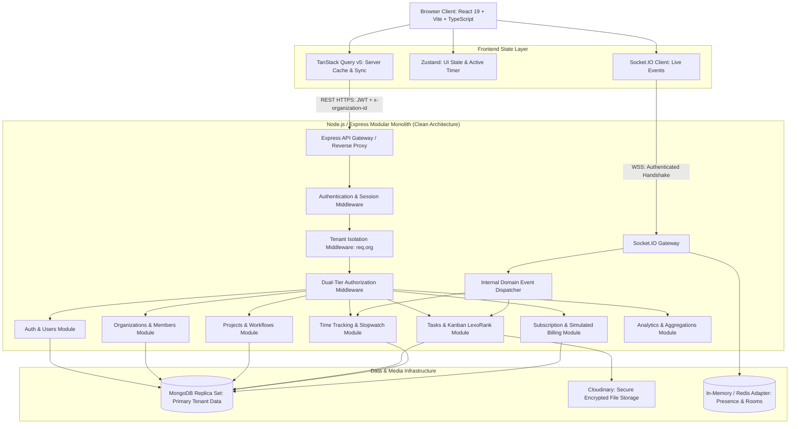
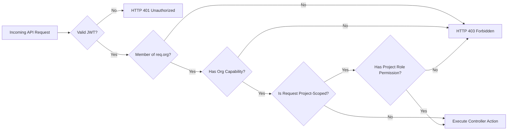

# TaskFlow Technical System Architecture Specification

- **Document Version**: v1.0 (Approved Baseline)
- **Status**: Approved & Baseline Locked
- **Date**: 2026-11-18
- **Project Directory**: `_bmad-output/planning-artifacts/architecture`

---

## 1. Executive Architecture Summary & Stack Evaluation

TaskFlow is architected as an **Enterprise-Grade Modular Monolith**. This topology delivers rapid iteration velocity, type safety across layers, transactional consistency via MongoDB multi-document transactions, and zero cross-network latency between services, while maintaining strict domain separation so individual domains can be extracted into microservices if future scale demands.



### 1.1 Stack Evaluation & Recommendations

| Technology Component | Specified Choice | Engineering Evaluation & Architectural Rationale |
| :--- | :--- | :--- |
| **Frontend Framework** | React 19 + Vite | **Approved**. Sub-second HMR in dev, tree-shaking, lightweight bundle size. |
| **Styling & Components**| Tailwind CSS + shadcn/ui | **Approved**. Unopinionated headless Radix primitives ensure 100% WCAG accessibility with zero runtime CSS overhead. |
| **Server State** | TanStack Query v5 | **Approved**. Automates background refetching, pagination caching, query key invalidation, and optimistic updates. |
| **Client UI State** | **Zustand** | **Approved over Redux Toolkit**. Avoids excessive boilerplate. Perfect fit for client timer ticks, modal toggles, and active workspace slug. |
| **Backend Runtime** | Node.js + Express + TypeScript | **Approved**. Non-blocking event loop ideal for concurrent I/O, shared TypeScript interfaces with frontend. |
| **Database** | MongoDB with Mongoose | **Approved**. Document model matches task hierarchies and dynamic project fields naturally. Multi-document transactions utilized for financial simulation and member provisioning. |
| **Real-Time Gateway** | Socket.IO | **Approved**. Automatic WebSocket fallback, native room abstraction (`org:<id>`, `project:<id>`), and heartbeat presence. |
| **Validation Layer** | Zod | **Approved**. Universal single source of truth: frontend forms and backend request bodies validate against identical schemas. |
| **File Storage** | Cloudinary | **Approved**. Secure signed URL uploads, automatic thumbnailing, image transformations, and malware/MIME checking. |

---

## 2. Directory & Module Boundaries

### 2.1 Backend Folder Structure (Modular Monolith)

```
backend/
├── src/
│   ├── config/                     # Environment variables, database connection, constants
│   │   ├── env.ts                  # Zod-validated process.env schema
│   │   ├── database.ts             # Mongoose connection with replica set support
│   │   └── cloudinary.ts           # Cloudinary SDK configuration
│   ├── middleware/                 # Shared cross-cutting middleware
│   │   ├── authenticate.ts         # JWT access token validation & user session injection
│   │   ├── tenantContext.ts        # x-organization-id extraction & organization boundary guard
│   │   ├── authorize.ts            # Tier 1 & Tier 2 RBAC/PBAC permission check middleware
│   │   ├── validateRequest.ts      # Zod request body/query validation interceptor
│   │   ├── rateLimiter.ts          # Express rate limiting for auth & general endpoints
│   │   └── errorHandler.ts         # Centralized error formatter (no leaked stack traces)
│   ├── modules/                    # Self-contained business domains
│   │   ├── auth/                   # Registration, login, token refresh, password resets
│   │   │   ├── auth.controller.ts
│   │   │   ├── auth.service.ts
│   │   │   ├── auth.routes.ts
│   │   │   ├── auth.schemas.ts
│   │   │   └── auth.types.ts
│   │   ├── organizations/          # Workspaces, member invites, roles
│   │   ├── projects/               # Projects, workflows, member assignments
│   │   ├── tasks/                  # Tasks, Kanban columns, LexoRank reordering
│   │   ├── comments/               # Task comments with internal note privacy filter
│   │   ├── attachments/            # Secure file upload & Cloudinary integration
│   │   ├── time-tracking/          # Active stopwatch sessions & manual time entries
│   │   ├── subscriptions/          # Quotas, plan changes, simulated payments
│   │   ├── reports/                # Aggregation pipelines for velocity & timesheets
│   │   └── super-admin/            # Platform telemetry, tenant suspension
│   ├── models/                     # Mongoose schema and model definitions
│   │   ├── User.ts
│   │   ├── Organization.ts
│   │   ├── OrganizationMember.ts
│   │   ├── Project.ts
│   │   ├── Task.ts
│   │   ├── TaskComment.ts
│   │   ├── TimeEntry.ts
│   │   └── ... (All 20 collections)
│   ├── real-time/                  # Socket.IO event gateway
│   │   ├── socketServer.ts         # Server bootstrap & connection authentication
│   │   ├── roomManager.ts          # Room join/leave logic (org, project, task)
│   │   ├── presenceService.ts      # Heartbeat tracker for online/offline presence
│   │   └── eventBroadcaster.ts     # Internal event bus to WebSocket dispatch bridge
│   ├── utils/                      # Helper libraries
│   │   ├── lexorank.ts             # Midpoint calculation & rebalancing algorithms
│   │   ├── cycleDetector.ts        # DFS directed acyclic graph validator for dependencies
│   │   └── tokenGenerator.ts       # Secure cryptographic tokens
│   ├── app.ts                      # Express application assembly
│   └── server.ts                   # HTTP & WebSocket server listen entrypoint
└── tests/                          # Integration, unit, and isolation test suites
```

### 2.2 Frontend Folder Structure

```
frontend/
├── src/
│   ├── assets/                     # Static images, SVG illustrations
│   ├── components/                 # Reusable UI component library (shadcn/ui)
│   │   ├── ui/                     # Primitives: Button, Dialog, Sheet, Dropdown, Table
│   │   ├── layout/                 # Shells: Navbar, Sidebar, Breadcrumbs, QuotaMeter
│   │   ├── command/                # Global Ctrl+K Command Palette
│   │   ├── drawer/                 # TaskDetailsDrawer & UnsavedChangesModal
│   │   ├── kanban/                 # KanbanBoard, KanbanColumn, TaskCard
│   │   └── timer/                  # Topbar StopwatchWidget
│   ├── features/                   # Domain-scoped feature modules
│   │   ├── auth/                   # Login, Register, Forgot Password forms
│   │   ├── dashboard/              # Role-specific executive and member dashboards
│   │   ├── projects/               # Project Hub, Settings, Member selector
│   │   ├── tasks/                  # List View, Gantt Timeline, Task filters
│   │   ├── timesheets/             # Timesheet matrix, Manual time log modal
│   │   ├── reports/                # Velocity charts, Time distribution graphs
│   │   ├── billing/                # Plan comparison grid, Simulated checkout modal
│   │   └── team/                   # Member directory table, Invite modal
│   ├── hooks/                      # Custom React hooks
│   │   ├── useSocket.ts            # Socket.IO connection & event subscription
│   │   ├── useStopwatch.ts         # Active stopwatch tick & sync hook
│   │   ├── usePermissions.ts       # RBAC/PBAC capability query helper
│   │   └── useDebounce.ts          # Search input debouncer
│   ├── lib/                        # Infrastructure singletons
│   │   ├── api.ts                  # Axios / Fetch client with automatic token refresh
│   │   ├── queryClient.ts          # TanStack Query client configuration
│   │   └── socket.ts               # Socket.IO client instance
│   ├── stores/                     # Zustand stores (Client transient state only)
│   │   ├── useAuthStore.ts         # Current user session & active org ID
│   │   ├── useUIStore.ts           # Sidebar collapsed, active modals
│   │   └── useTimerStore.ts        # Running timer state & local tick counter
│   ├── types/                      # Shared TypeScript definitions & API contracts
│   ├── router/                     # React Router route tree with auth guards
│   ├── App.tsx
│   └── main.tsx
```

---

## 3. Core Architectural Mechanisms

### 3.1 Authentication & Session Architecture
- **Dual-Token Pattern**:
  - **Access Token**: Short-lived JWT (15-minute expiration) containing `{ userId, isSuperAdmin }`. Sent in `Authorization: Bearer <token>` header.
  - **Refresh Token**: High-entropy cryptographically random string (7-day expiration). Stored in MongoDB `UserSessions` collection (hashed with SHA-256) and delivered via an `HttpOnly; Secure; SameSite=Strict` cookie (`/api/v1/auth/refresh`).
- **Automatic Silent Refresh**:
  - The frontend Axios/Fetch client intercepts HTTP `401 Unauthorized`. It transparently pauses pending requests, calls `/api/v1/auth/refresh`, updates the in-memory access token, and retries the original request without user interruption.

### 3.2 Multi-Tenant Data Isolation Strategy
- **Shared Database, Shared Collections with Discriminator Key**:
  - All tenant records share MongoDB collections, strictly tagged with `organizationId: ObjectId`.
- **Backend Tenant Guard Middleware (`tenantContext.ts`)**:
  - Extracts active workspace from `x-organization-id` header.
  - Queries `OrganizationMembers` for `{ organizationId: req.headers['x-organization-id'], userId: req.user._id, status: 'active' }`.
  - Attaches verified `req.org` and `req.membership` to the request object.
  - **Enforcement Rule**: Every Mongoose service query MUST explicitly append `{ organizationId: req.org._id }`.
  - Foreign ID tampering: If an attacker crafts `GET /api/v1/projects/:id` using a projectId from another tenant, the query `{ _id: id, organizationId: req.org._id }` returns `null`, yielding a safe `404 Not Found`.

### 3.3 Authorization Architecture (Dual-Tier Middleware)



- **Express Middleware Signature**:
  - `requireOrgPermission(Capability.MANAGE_BILLING)` &rarr; Verifies Org Owner or Org Admin.
  - `requireProjectPermission(Capability.DRAG_KANBAN)` &rarr; Verifies Tier 2 role inside target project.

### 3.4 Real-Time Event & Presence Architecture (Socket.IO)
- **Authentication Handshake**:
  - Socket.IO connection initializes with access token in query/auth payload: `io({ auth: { token } })`.
  - Connection verified via JWT; socket is tagged with authenticated `userId`.
- **Room Subscriptions**:
  - Upon switching workspace &rarr; client emits `join:org { orgId }`. Server checks membership before joining room `org:<orgId>`.
  - Opening a project board &rarr; client emits `join:project { projectId }`. Server checks project access before joining room `project:<projectId>`.
  - Opening a task drawer &rarr; client emits `join:task { taskId }`. Joins room `task:<taskId>`.
- **Presence Heartbeat**:
  - In-memory registry `Map<orgId, Map<userId, { socketId, status, lastSeen }>>`.
  - Client sends ping every 25s. If ping misses for 45s, status updates to `offline`, emitting `presence:change` to `org:<orgId>`.

### 3.5 Secure File Upload Architecture (Cloudinary)
- **Direct-to-Cloud Upload Flow (No Node.js Memory Bottleneck)**:
  1. Frontend requests signature: `POST /api/v1/attachments/signature { taskId, fileName, fileType, fileSize }`.
  2. Backend validates file type (MIME whitelist) and size (<10MB); ensures user is not an `Org Guest`.
  3. Backend returns signed parameters (timestamp, HMAC-SHA1 signature, Cloudinary API key).
  4. Frontend streams binary directly to Cloudinary API.
  5. Frontend posts Cloudinary asset metadata back to backend: `POST /api/v1/attachments/complete`.
  6. Backend stores record in `TaskAttachments` and dispatches `attachment:uploaded` event over Socket.IO.

### 3.6 Error Handling, Telemetry & Logging
- **Standardized API Error Response Schema**:
  ```json
  {
    "success": false,
    "error": {
      "code": "PROJECT_QUOTA_EXCEEDED",
      "message": "Your organization has reached the limit of 3 projects on the Free plan.",
      "details": { "current": 3, "max": 3, "upgradeUrl": "/settings/billing" }
    }
  }
  ```
- **Logging Pipeline**: Winston / Pino structured JSON logging. Formats timestamps, correlation IDs (`reqId`), and tenant IDs on all log lines while redacting passwords, tokens, and payment card details.
