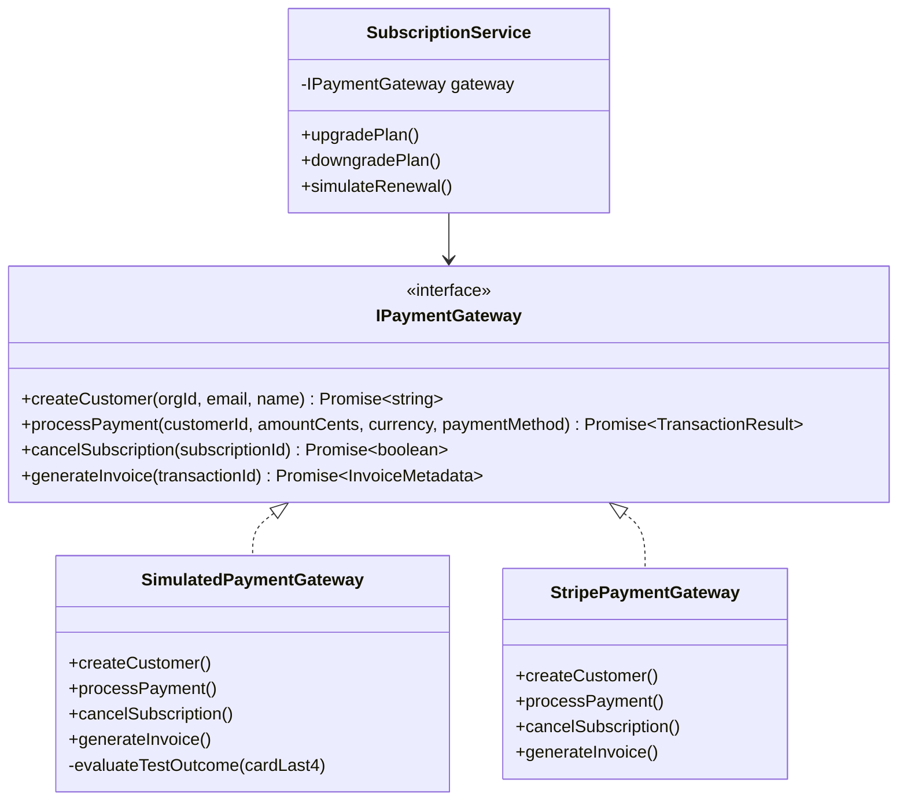

# TaskFlow Payment Simulation & Subscription Lifecycle Specification

- **Document Version**: v1.0 (Approved Baseline)
- **Status**: Approved & Baseline Locked
- **Date**: 2026-11-18
- **Project Directory**: `_bmad-output/planning-artifacts/billing`

---

## 1. Architectural Strategy & Gateway Agnostic Design

TaskFlow implements a **Payment Provider Adapter Pattern** (`IPaymentGateway`). The entire SaaS subscription lifecycle (checkout, upgrades, downgrades, renewals, invoice history) operates against this clean abstraction. 

In development and initial deployment, the `SimulatedPaymentGateway` handles all operations without external API calls or real money. When transitioning to production, a `StripePaymentGateway` can be swapped in via dependency injection without refactoring subscription business rules, quota checks, or database models.

---

## 2. Simulated Subscription Plans & Feature Matrix

| Feature Dimension | Free Plan | Pro Plan | Business Plan |
| :--- | :---: | :---: | :---: |
| **Simulated Price** | \$0 / month | \$12 / seat / month | \$25 / seat / month |
| **Active Projects Quota**| 3 active projects | Unlimited (`-1`) | Unlimited (`-1`) |
| **Member Seats Quota** | 5 members | Unlimited (`-1`) | Unlimited (`-1`) |
| **Views Supported** | Kanban, List | Kanban, List, Calendar, Gantt | All Views |
| **Time Tracking** | Manual Logs Only | Active Stopwatch + Manual | Active Stopwatch + Manual |
| **Collaboration** | Standard Comments | Standard + Presence Sync | Standard + Presence Sync |
| **Reporting** | Basic Task Counts | Velocity & Time Reports | Advanced Org Analytics |
| **Governance** | Standard RBAC | Standard RBAC | Custom Roles & Audit Logs |
| **Simulated Billing** | Free Receipt | Simulated PDF Invoices | Simulated PDF Invoices |

---

## 3. Simulated Checkout & Test Harness Matrix

The frontend checkout modal provides realistic credit card inputs, but strictly requires simulated test cards. The system inspects the last 4 digits of the card number to deterministically simulate payment outcomes:

| Test Card Number | Expiration / CVC | Simulated Outcome | HTTP Response & Error Code | User Experience / UI Feedback |
| :--- | :---: | :---: | :---: | :---: |
| `4242 4242 4242 4242` | Any future / 123 | **SUCCESS** | `200 OK` (`simulated_success`) | Green success modal; instant plan upgrade & feature unlock. |
| `4000 0000 0000 0002` | Any future / 123 | **CARD_DECLINED** | `402 Payment Required` | Red alert: "Simulated payment failed: Insufficient funds." |
| `4000 0000 0000 0003` | Any future / 123 | **EXPIRED_CARD** | `402 Payment Required` | Red alert: "Simulated payment failed: Card expired." |
| `4000 0000 0000 0004` | Any future / 123 | **GATEWAY_TIMEOUT**| `504 Gateway Timeout` | Amber alert: "Simulated bank timeout. Please retry." |

### 3.1 Strict Financial Safety & UI Disclaimers
1. **Prominent UI Notice**: The checkout modal, invoice receipts, and billing history tables permanently display a bold banner:  
   `⚠️ SIMULATION ENVIRONMENT - NO REAL FINANCIAL TRANSACTIONS OCCUR`.
2. **Zero Storage of PAN**: Actual primary account numbers (PAN) are never persisted in the database; only sanitized strings like `brand: "Visa", last4: "4242"` are saved in `PaymentTransactions`.

---

## 4. Complete Subscription Lifecycle Workflows

### 4.1 Plan Upgrade Workflow (e.g. Free &rarr; Pro)
1. **Initiation**: Org Owner navigates to `/settings/billing` and selects "Upgrade to Pro".
2. **Calculation**: Frontend calculates `Total = Active Seat Count * $12.00`.
3. **Execution**: Org Owner inputs test card `...4242` and clicks "Confirm Simulated Upgrade".
4. **Backend Transaction**:
   - Creates `PaymentTransaction` document (`status: "simulated_success"`).
   - Updates `OrganizationSubscription` record to `planKey: "pro"`, setting `currentPeriodStart = now` and `currentPeriodEnd = now + 30 days`.
   - Generates simulated invoice record (`SIM-INV-YYYY-XXXX`).
5. **Real-Time Entitlement Unlock**: Backend emits `subscription:updated` to Socket.IO room `org:<orgId>`. All connected members immediately gain access to Gantt charts, active stopwatch timers, and velocity reports without refreshing.

### 4.2 Graceful Downgrade Workflow (e.g. Pro &rarr; Free)
1. **Pre-flight Check**: Org Owner clicks "Downgrade to Free".
2. **Impact Calculation**: API returns current usage (e.g., 8 projects, 11 members) vs Free limits (3 projects, 5 members).
3. **Owner Selection**: Modal forces Org Owner to choose exactly 3 active projects.
4. **Atomic Downgrade Execution**:
   - Excess projects are updated to `status: "archived_read_only"`. Their data remains completely intact and readable by authorized members, but mutations are disabled.
   - Excess members beyond 5 are updated to `status: "inactive"`, preserving their historical time entries, task comments, and activity logs.
   - Updates `OrganizationSubscription` to `planKey: "free"`.
5. **Feedback**: Quota meters in the sidebar footer adjust to show `3 / 3 Projects (100%)` and `5 / 5 Members (100%)`.

### 4.3 Automated Renewal Simulation & Expiration Cron
- **Simulated Daily Billing Cron Job**:
  - Scans `OrganizationSubscriptions` where `currentPeriodEnd <= now` and `planKey != "free"`.
  - If `cancelAtPeriodEnd: true` &rarr; triggers Graceful Downgrade to Free.
  - If `cancelAtPeriodEnd: false` &rarr; triggers simulated renewal charge:
    - On success: Advances `currentPeriodEnd` by +30 days, generates new simulated invoice.
    - On failure: Transitions status to `past_due` with a 3-day grace period before transitioning to `archived_read_only`.

---

## 5. Simulated Invoices & Receipt Generation

- Every successful simulated transaction generates a structured invoice record in `PaymentTransactions`.
- The system renders a downloadable, printable simulated receipt (HTML/PDF preview) containing:
  - Header: TaskFlow Simulated Billing Division.
  - Customer: Organization Name, Owner Email, Address.
  - Line Items: "TaskFlow Pro Plan Subscription (Seats: X)" with subtotal, simulated tax ($0.00), and total paid.
  - Prominent Watermark: `SIMULATED TEST INVOICE - NOT A LEGAL TAX RECEIPT`.
