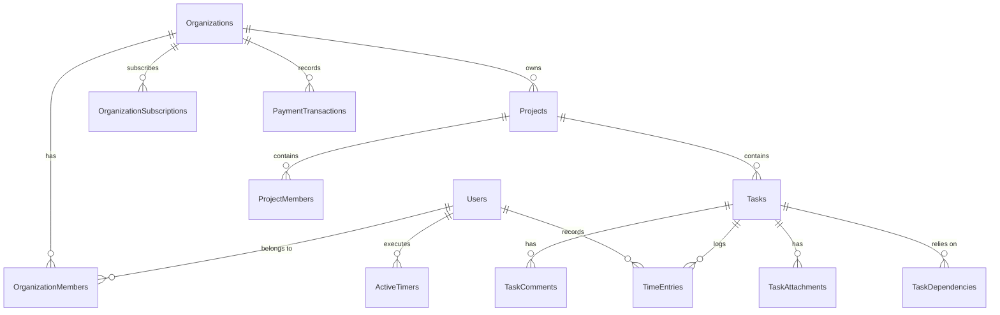

# TaskFlow Complete MongoDB Database Design Specification

- **Document Version**: v1.0 (Approved Baseline)
- **Status**: Approved & Baseline Locked
- **Date**: 2026-11-18
- **Project Directory**: `_bmad-output/planning-artifacts/database`

---

## 1. Data Modeling Architecture & Multi-Tenant Conventions

TaskFlow utilizes **MongoDB with Mongoose ODM** under a multi-tenant shared-collection model.

### 1.1 Core Tenant Isolation Rules
1. **Tenant Discriminator**: Every tenant-owned document MUST contain an `organizationId: ObjectId` reference to `Organizations._id`.
2. **Compound Index Invariant**: Every query on tenant data leverages compound indexes beginning with `organizationId` (e.g. `{ organizationId: 1, projectId: 1, status: 1 }`).
3. **Soft-Delete Strategy**: Business records (`Projects`, `Tasks`, `Organizations`, `TimeEntries`) use `isDeleted: Boolean` (default: `false`) and `deletedAt: Date | null` to preserve auditability and prevent orphan references. Queries default to `{ isDeleted: false }`.

---

## 2. Complete Collections Schema Specifications (21 Collections)

---

### Collection 1: `Users`
- **Purpose**: Global user identities across the entire SaaS platform.
- **Fields**:
  - `_id`: `ObjectId`
  - `email`: `String` (Required, unique, lowercase, trimmed)
  - `passwordHash`: `String` (Required, bcrypt hash)
  - `fullName`: `String` (Required, max 100)
  - `displayName`: `String` (Optional, max 50)
  - `avatarUrl`: `String` (Optional, Cloudinary URL)
  - `isSuperAdmin`: `Boolean` (Default: `false`)
  - `status`: `String` (Enum: `active`, `suspended`, `pending_verification`, default: `active`)
  - `preferences`: `Object` (Theme: `light`|`dark`|`system`, notifications: `Object`)
  - `createdAt`, `updatedAt`: `Date`
- **Indexes**:
  - `{ email: 1 }` (Unique)
  - `{ isSuperAdmin: 1 }` (Sparse)

---

### Collection 2: `UserSessions`
- **Purpose**: Active refresh-token sessions for silent auth rotation.
- **Fields**:
  - `_id`: `ObjectId`
  - `userId`: `ObjectId` (Ref: `Users`, required)
  - `refreshTokenHash`: `String` (Required, SHA-256)
  - `userAgent`: `String`
  - `ipAddress`: `String`
  - `expiresAt`: `Date` (Required)
  - `createdAt`: `Date`
- **Indexes**:
  - `{ userId: 1 }`
  - `{ expiresAt: 1 }` (TTL index: automatically deletes expired sessions)

---

### Collection 3: `Organizations`
- **Purpose**: High-level multi-tenant workspace accounts.
- **Fields**:
  - `_id`: `ObjectId`
  - `name`: `String` (Required, max 100)
  - `slug`: `String` (Required, unique, lowercase, URL-safe)
  - `logoUrl`: `String` (Optional)
  - `ownerId`: `ObjectId` (Ref: `Users`, required)
  - `status`: `String` (Enum: `active`, `suspended`, `archived`, default: `active`)
  - `suspensionReason`: `String` (Optional)
  - `isDeleted`: `Boolean` (Default: `false`)
  - `deletedAt`: `Date` (Optional)
  - `createdAt`, `updatedAt`: `Date`
- **Indexes**:
  - `{ slug: 1 }` (Unique)
  - `{ ownerId: 1 }`
  - `{ status: 1 }`

---

### Collection 4: `OrganizationMembers`
- **Purpose**: User membership, Tier 1 roles, and status within a specific tenant.
- **Fields**:
  - `_id`: `ObjectId`
  - `organizationId`: `ObjectId` (Ref: `Organizations`, required)
  - `userId`: `ObjectId` (Ref: `Users`, required)
  - `role`: `String` (Enum: `owner`, `admin`, `member`, `guest`, required)
  - `customRoleId`: `ObjectId` (Ref: `Roles`, optional, Business tier)
  - `status`: `String` (Enum: `active`, `inactive`, `invited`, default: `active`)
  - `joinedAt`: `Date` (Default: `Date.now`)
  - `hourlyRate`: `Number` (Optional, billable rate in cents)
  - `createdAt`, `updatedAt`: `Date`
- **Indexes**:
  - `{ organizationId: 1, userId: 1 }` (Unique compound index)
  - `{ organizationId: 1, role: 1 }`
  - `{ organizationId: 1, status: 1 }`

---

### Collection 5: `Invitations`
- **Purpose**: Pending member invitations to organizations.
- **Fields**:
  - `_id`: `ObjectId`
  - `organizationId`: `ObjectId` (Ref: `Organizations`, required)
  - `email`: `String` (Required, lowercase)
  - `role`: `String` (Enum: `admin`, `member`, `guest`, required)
  - `invitedBy`: `ObjectId` (Ref: `Users`, required)
  - `token`: `String` (Required, unique cryptographic token)
  - `status`: `String` (Enum: `pending`, `accepted`, `expired`, `revoked`, default: `pending`)
  - `expiresAt`: `Date` (Required, 72 hours from creation)
  - `createdAt`: `Date`
- **Indexes**:
  - `{ token: 1 }` (Unique)
  - `{ organizationId: 1, email: 1 }` (Compound)
  - `{ expiresAt: 1 }` (TTL index)

---

### Collection 6: `Roles` & Collection 7: `Permissions`
- **Purpose**: Dynamic role-based and permission-based authorization engine (Business tier custom roles).
- **Roles Fields**:
  - `_id`: `ObjectId`
  - `organizationId`: `ObjectId` (Ref: `Organizations`, required)
  - `name`: `String` (Required, max 50)
  - `permissions`: `[String]` (List of permission string keys, e.g. `task:create`, `kanban:edit`, `reports:view`)
  - `isCustom`: `Boolean` (Default: `true`)
  - `createdAt`, `updatedAt`: `Date`
- **Indexes**:
  - `{ organizationId: 1, name: 1 }` (Unique)

---

### Collection 8: `Projects`
- **Purpose**: Projects containing workflows, boards, tasks, and milestone schedules.
- **Fields**:
  - `_id`: `ObjectId`
  - `organizationId`: `ObjectId` (Ref: `Organizations`, required)
  - `name`: `String` (Required, max 100)
  - `key`: `String` (Required, uppercase, 2-10 chars, e.g. `ACME`)
  - `description`: `String` (Optional, max 1000)
  - `leadId`: `ObjectId` (Ref: `Users`, required)
  - `status`: `String` (Enum: `active`, `archived_read_only`, `completed`, default: `active`)
  - `targetDeliveryDate`: `Date` (Optional)
  - `isDeleted`: `Boolean` (Default: `false`)
  - `deletedAt`: `Date` (Optional)
  - `createdAt`, `updatedAt`: `Date`
- **Indexes**:
  - `{ organizationId: 1, key: 1 }` (Unique compound)
  - `{ organizationId: 1, status: 1 }`
  - `{ organizationId: 1, leadId: 1 }`

---

### Collection 9: `ProjectMembers`
- **Purpose**: Tier 2 project-specific access control and roles.
- **Fields**:
  - `_id`: `ObjectId`
  - `organizationId`: `ObjectId` (Ref: `Organizations`, required)
  - `projectId`: `ObjectId` (Ref: `Projects`, required)
  - `userId`: `ObjectId` (Ref: `Users`, required)
  - `role`: `String` (Enum: `project_manager`, `team_lead`, `member`, `viewer`, required)
  - `assignedAt`: `Date` (Default: `Date.now`)
- **Indexes**:
  - `{ projectId: 1, userId: 1 }` (Unique compound)
  - `{ organizationId: 1, userId: 1 }`

---

### Collection 10: `Tasks`
- **Purpose**: Individual work items managed across Kanban, List, Calendar, and Gantt views.
- **Fields**:
  - `_id`: `ObjectId`
  - `organizationId`: `ObjectId` (Ref: `Organizations`, required)
  - `projectId`: `ObjectId` (Ref: `Projects`, required)
  - `taskNumber`: `Number` (Incremental sequential ID per project, e.g. `104`)
  - `displayId`: `String` (Computed: `${projectKey}-${taskNumber}`, e.g. `ACME-104`)
  - `title`: `String` (Required, max 255)
  - `description`: `String` (Optional, Markdown supported)
  - `columnId`: `String` (Required, e.g. `in_progress`)
  - `status`: `String` (Enum: `backlog`, `todo`, `in_progress`, `review`, `done`, required)
  - `order`: `String` (Required, LexoRank fractional index string, e.g. `0|i00000:`)
  - `priority`: `String` (Enum: `low`, `medium`, `high`, `urgent`, default: `medium`)
  - `assigneeId`: `ObjectId` (Ref: `Users`, optional)
  - `reporterId`: `ObjectId` (Ref: `Users`, required)
  - `labels`: `[String]` (Tags)
  - `storyPoints`: `Number` (Optional, positive integer)
  - `startDate`: `Date` (Optional)
  - `dueDate`: `Date` (Optional)
  - `estimatedHours`: `Number` (Optional)
  - `version`: `Number` (Default: `1`, optimistic concurrency locking)
  - `isDeleted`: `Boolean` (Default: `false`)
  - `deletedAt`: `Date`
  - `createdAt`, `updatedAt`: `Date`
- **Indexes**:
  - `{ projectId: 1, taskNumber: 1 }` (Unique compound)
  - `{ projectId: 1, columnId: 1, order: 1 }` (Kanban query performance)
  - `{ organizationId: 1, assigneeId: 1, status: 1 }` (My Work query)
  - `{ organizationId: 1, dueDate: 1 }` (Calendar view)

---

### Collection 11: `TaskComments`
- **Purpose**: Discussion threads and internal notes on tasks.
- **Fields**:
  - `_id`: `ObjectId`
  - `organizationId`: `ObjectId` (Ref: `Organizations`, required)
  - `projectId`: `ObjectId` (Ref: `Projects`, required)
  - `taskId`: `ObjectId` (Ref: `Tasks`, required)
  - `authorId`: `ObjectId` (Ref: `Users`, required)
  - `text`: `String` (Required, max 5000)
  - `isInternal`: `Boolean` (Required, default: `false`, Team-internal note privacy flag)
  - `isEdited`: `Boolean` (Default: `false`)
  - `createdAt`, `updatedAt`: `Date`
- **Indexes**:
  - `{ taskId: 1, createdAt: 1 }`
  - `{ organizationId: 1, isInternal: 1 }`

---

### Collection 12: `TaskAttachments`
- **Purpose**: File metadata uploaded to Cloudinary associated with tasks.
- **Fields**:
  - `_id`: `ObjectId`
  - `organizationId`: `ObjectId` (Ref: `Organizations`, required)
  - `projectId`: `ObjectId` (Ref: `Projects`, required)
  - `taskId`: `ObjectId` (Ref: `Tasks`, required)
  - `uploaderId`: `ObjectId` (Ref: `Users`, required)
  - `fileName`: `String` (Required)
  - `fileSize`: `Number` (Required, in bytes)
  - `mimeType`: `String` (Required)
  - `cloudinaryPublicId`: `String` (Required)
  - `secureUrl`: `String` (Required, HTTPS URL)
  - `createdAt`: `Date`
- **Indexes**:
  - `{ taskId: 1, createdAt: -1 }`

---

### Collection 13: `TaskDependencies`
- **Purpose**: Predecessor-successor links for Timeline/Gantt charts.
- **Fields**:
  - `_id`: `ObjectId`
  - `organizationId`: `ObjectId` (Ref: `Organizations`, required)
  - `projectId`: `ObjectId` (Ref: `Projects`, required)
  - `predecessorTaskId`: `ObjectId` (Ref: `Tasks`, required)
  - `successorTaskId`: `ObjectId` (Ref: `Tasks`, required)
  - `dependencyType`: `String` (Enum: `finish_to_start`, default: `finish_to_start`)
  - `createdAt`: `Date`
- **Indexes**:
  - `{ predecessorTaskId: 1, successorTaskId: 1 }` (Unique compound)
  - `{ projectId: 1 }`

---

### Collection 14: `Labels`
- **Purpose**: Taxonomy and categorization tags within an organization.
- **Fields**:
  - `_id`: `ObjectId`
  - `organizationId`: `ObjectId` (Ref: `Organizations`, required)
  - `name`: `String` (Required, max 30)
  - `color`: `String` (Required, Hex color, e.g. `#4F46E5`)
  - `createdAt`: `Date`
- **Indexes**:
  - `{ organizationId: 1, name: 1 }` (Unique compound)

---

### Collection 15: `Notifications`
- **Purpose**: In-app alerts, mentions, and assignment events.
- **Fields**:
  - `_id`: `ObjectId`
  - `organizationId`: `ObjectId` (Ref: `Organizations`, required)
  - `recipientId`: `ObjectId` (Ref: `Users`, required)
  - `senderId`: `ObjectId` (Ref: `Users`, required)
  - `type`: `String` (Enum: `mention`, `assignment`, `status_change`, `deadline_reminder`)
  - `title`: `String` (Required)
  - `message`: `String` (Required)
  - `targetUrl`: `String` (Required, e.g. `/projects/p1/kanban?task=TASK-102`)
  - `isRead`: `Boolean` (Default: `false`)
  - `readAt`: `Date`
  - `createdAt`: `Date`
- **Indexes**:
  - `{ recipientId: 1, isRead: 1, createdAt: -1 }`
  - `{ organizationId: 1 }`

---

### Collection 16: `TimeEntries`
- **Purpose**: Historical completed work logs (manual or flushed from active stopwatch).
- **Fields**:
  - `_id`: `ObjectId`
  - `organizationId`: `ObjectId` (Ref: `Organizations`, required)
  - `projectId`: `ObjectId` (Ref: `Projects`, required)
  - `taskId`: `ObjectId` (Ref: `Tasks`, required)
  - `userId`: `ObjectId` (Ref: `Users`, required)
  - `date`: `Date` (Required, calendar date worked)
  - `durationMinutes`: `Number` (Required, positive integer)
  - `isBillable`: `Boolean` (Required, default: `true`)
  - `hourlyRateSnapshot`: `Number` (Snapshot of hourly rate in cents at time of entry)
  - `notes`: `String` (Optional, max 1000)
  - `isDeleted`: `Boolean` (Default: `false`)
  - `createdAt`, `updatedAt`: `Date`
- **Indexes**:
  - `{ organizationId: 1, userId: 1, date: -1 }`
  - `{ taskId: 1 }`
  - `{ projectId: 1, date: -1 }`

---

### Collection 17: `ActiveTimers`
- **Purpose**: Real-time state of running stopwatch sessions (Single-active-timer lock).
- **Fields**:
  - `_id`: `ObjectId`
  - `organizationId`: `ObjectId` (Ref: `Organizations`, required)
  - `projectId`: `ObjectId` (Ref: `Projects`, required)
  - `taskId`: `ObjectId` (Ref: `Tasks`, required)
  - `userId`: `ObjectId` (Ref: `Users`, required, UNIQUE lock)
  - `startTime`: `Date` (Required)
  - `isRunning`: `Boolean` (Required, default: `true`)
  - `isBillable`: `Boolean` (Default: `true`)
  - `notes`: `String` (Optional)
- **Indexes**:
  - `{ userId: 1 }` (Unique: guarantees strictly ONE active timer per user across platform)
  - `{ organizationId: 1 }`

---

### Collection 18: `ActivityLogs`
- **Purpose**: Workspace chronological activity stream for dashboard feeds.
- **Fields**:
  - `_id`: `ObjectId`
  - `organizationId`: `ObjectId` (Ref: `Organizations`, required)
  - `projectId`: `ObjectId` (Ref: `Projects`, optional)
  - `userId`: `ObjectId` (Ref: `Users`, required)
  - `action`: `String` (Required, e.g. `task:created`, `task:moved`, `member:joined`)
  - `metadata`: `Object`
  - `createdAt`: `Date`
- **Indexes**:
  - `{ organizationId: 1, createdAt: -1 }`
  - `{ projectId: 1, createdAt: -1 }`

---

### Collection 19: `SubscriptionPlans`
- **Purpose**: Global SaaS pricing tier definitions (`Free`, `Pro`, `Business`).
- **Fields**:
  - `_id`: `ObjectId`
  - `planKey`: `String` (Required, unique enum: `free`, `pro`, `business`)
  - `name`: `String` (Required, e.g. "Pro Plan")
  - `monthlyPriceCents`: `Number` (Required, e.g. 1200 = $12.00)
  - `maxProjects`: `Number` (3 for free, -1 for unlimited)
  - `maxMembers`: `Number` (5 for free, -1 for unlimited)
  - `features`: `Object` (Timeline: `true`, activeTimer: `true`, auditLogs: `false`, etc.)
  - `isActive`: `Boolean` (Default: `true`)
- **Indexes**:
  - `{ planKey: 1 }` (Unique)

---

### Collection 20: `OrganizationSubscriptions`
- **Purpose**: Current active plan and billing status for a tenant.
- **Fields**:
  - `_id`: `ObjectId`
  - `organizationId`: `ObjectId` (Ref: `Organizations`, required, unique)
  - `planKey`: `String` (Required, Ref: `SubscriptionPlans.planKey`)
  - `status`: `String` (Enum: `active`, `trialing`, `past_due`, `canceled`, default: `active`)
  - `currentPeriodStart`: `Date` (Required)
  - `currentPeriodEnd`: `Date` (Required)
  - `cancelAtPeriodEnd`: `Boolean` (Default: `false`)
  - `createdAt`, `updatedAt`: `Date`
- **Indexes**:
  - `{ organizationId: 1 }` (Unique compound)

---

### Collection 21: `PaymentTransactions`
- **Purpose**: Complete audit history of simulated payments, upgrades, and invoice records.
- **Fields**:
  - `_id`: `ObjectId`
  - `organizationId`: `ObjectId` (Ref: `Organizations`, required)
  - `transactionNumber`: `String` (Required, unique, e.g. `SIM-INV-2026-0042`)
  - `amountCents`: `Number` (Required)
  - `currency`: `String` (Default: `USD`)
  - `status`: `String` (Enum: `simulated_success`, `simulated_failure`, `simulated_refund`)
  - `planKey`: `String` (Required)
  - `seatCount`: `Number` (Required)
  - `gateway`: `String` (Default: `simulated_gateway`)
  - `receiptUrl`: `String` (Simulated PDF download path)
  - `createdAt`: `Date`
- **Indexes**:
  - `{ transactionNumber: 1 }` (Unique)
  - `{ organizationId: 1, createdAt: -1 }`
