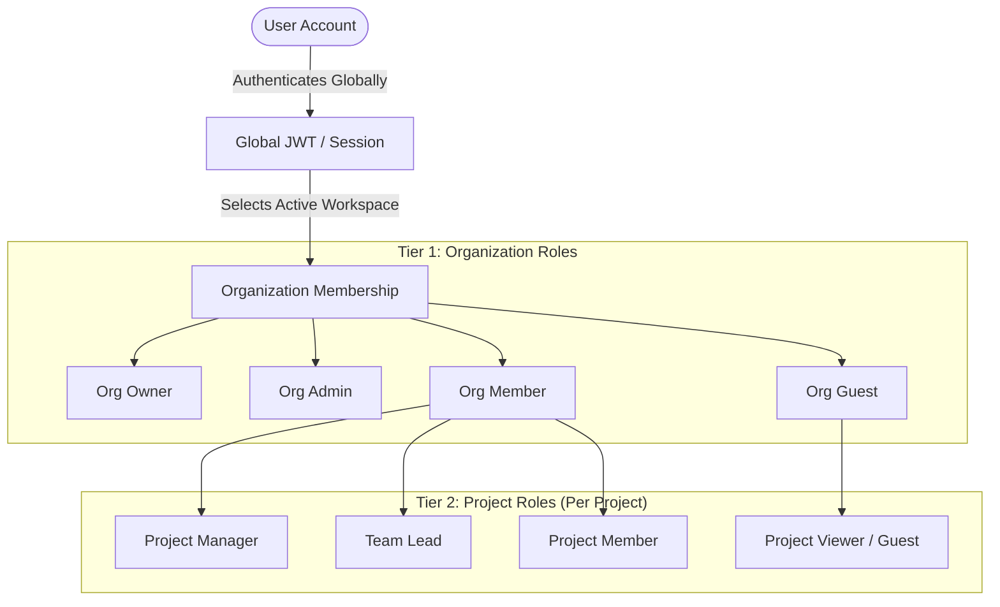

# Product Requirements Document (PRD): TaskFlow SaaS

- **Document Version**: v1.0 (Approved Baseline)
- **Status**: Approved & Baseline Locked
- **Date**: 2026-11-18
- **Project Directory**: `_bmad-output/planning-artifacts/prd`

---

## 1. Executive Summary & Vision

TaskFlow is a production-grade, multi-tenant B2B SaaS Project Management Platform engineered for modern distributed teams, engineering groups, agencies, and high-velocity organizations. 

TaskFlow eliminates fragmented productivity stacks by unifying **adaptive task management (Kanban, List, Calendar, Timeline/Gantt)**, **native time tracking (manual logs + active stopwatch timer)**, **contextual real-time collaboration (live presence, comments, card streaming)**, and **comprehensive organization governance** under a single multi-tenant workspace architecture.

### Primary Objectives
1. **Unify Execution**: Enable seamless planning, execution, and tracking without third-party integrations for core workflows.
2. **Strict Multi-Tenant Isolation**: Provide secure workspace partitioning where one user account can join and switch between multiple organizations with independent roles and data boundaries.
3. **Enterprise-Grade Governance**: Offer a dual-tier authorization model (Organization-level roles + Project-level permissions) protecting business-critical assets, billing, and audit logs.
4. **Self-Service Subscription Lifecycle**: Implement a robust subscription tier model (Free, Pro, Business) backed by an extensible simulation layer that transitions to production gateways without architecture refactoring.

---

## 2. Target Users & Personas

| Persona | Primary Needs & Pain Points | Key Workflows in TaskFlow |
| :--- | :--- | :--- |
| **Org Owner / Executive** | Absolute ownership over organizational assets, exclusive billing authority, capacity oversight. | Org dashboard, billing simulation, plan changes, audit logs, team allocation reports. |
| **Organization Admin** | Managing workspace members, invites, security settings, and global defaults. | User invitations, workspace customization, security & SSO settings, read-only billing overview. |
| **Project Manager** | Planning milestones, assigning sprint stories, monitoring dependencies, tracking deadlines. | Project creation, Gantt/Timeline view, Kanban configuration, burndown tracking. |
| **Team Lead** | Guiding daily team tasks, resolving roadblocks, reviewing time allocations. | Team Kanban, task reviews, live activity feed, team member workload. |
| **Team Member / Engineer** | Focus on assigned tasks, logging time accurately, context without distraction. | My Tasks view, active timer, task comments/mentions, real-time board updates. |
| **Guest / Client Viewer** | Transparent progress review on assigned projects without seeing internal notes, rates, or unshared projects. | Read-only project board, milestone reviews, public comment participation. |
| **Super Admin** | Platform-level operator managing tenants, platform health, global subscription templates, and compliance. | Super Admin portal, tenant suspension, global plan management, system telemetry. |

---

## 3. Multi-Tenancy & Authorization Architecture

### 3.1 Platform Identity vs. Tenant Membership
1. **Global Super Admin Isolation**:
   - Super Admin identity is managed independently via a distinct platform-level role flag (`isSuperAdmin: true`).
   - Super Admins access a dedicated control plane (`/admin-portal`) completely segregated from tenant workspace domains. Super Admins do not participate as members in tenant workspaces unless explicitly invited as an organization user.
2. **Multi-Tenant Account Federation**:
   - A single user account (`User`) authenticates globally.
   - Organization membership (`OrganizationMember`) stores the user's role specifically for that tenant.
   - Every tenant API request requires validation of the active `x-organization-id` header or session context.
   - All database queries strictly scope tenant context: `find({ organizationId: req.org._id, ... })`.

### 3.2 Dual-Tier Role & Permission Matrix (RBAC + PBAC)

TaskFlow enforces a strict two-tier authorization model:
- **Tier 1: Organization Role** (Governs platform administration, membership, billing, and organization-wide settings).
- **Tier 2: Project Role** (Governs project-level access, task management, workflows, and board manipulation).

#### Tier 1: Organization-Level Permissions

| Capability | Super Admin | Org Owner | Org Admin | Org Member | Org Guest |
| :--- | :---: | :---: | :---: | :---: | :---: |
| Access Super Admin Platform Portal | ✅ | ❌ | ❌ | ❌ | ❌ |
| Manage Platform Global Plans & Tenants | ✅ | ❌ | ❌ | ❌ | ❌ |
| Delete / Transfer Organization Ownership | ❌ | ✅ | ❌ | ❌ | ❌ |
| Change / Upgrade / Downgrade Subscription | ❌ | ✅ | ❌ (Owner Only) | ❌ | ❌ |
| View Invoices, Receipts & Billing History | ❌ | ✅ | ✅ (View Only) | ❌ | ❌ |
| Invite / Deactivate Organization Members | ❌ | ✅ | ✅ | ❌ | ❌ |
| Manage Custom Roles & Audit Logs (Business) | ❌ | ✅ | ✅ | ❌ | ❌ |
| Create New Projects (Within Plan Quota) | ❌ | ✅ | ✅ | ✅ (Configurable) | ❌ |
| View Org-Wide Reports & Timesheet Totals | ❌ | ✅ | ✅ | ❌ | ❌ |
| View Assigned Projects & Tasks | ❌ | ✅ | ✅ | ✅ | ✅ |

#### Tier 2: Project-Level Permissions

| Action Inside Assigned Project | Project Manager | Team Lead | Project Member | Guest / Client Viewer |
| :--- | :---: | :---: | :---: | :---: |
| Edit Project Settings & Archival | ✅ | ❌ | ❌ | ❌ |
| Add / Remove Project Members | ✅ | ❌ | ❌ | ❌ |
| Configure Kanban Columns & Workflows | ✅ | ✅ | ❌ | ❌ |
| Create & Assign Tasks | ✅ | ✅ | ✅ | ❌ |
| Edit Any Task Details & Dependencies | ✅ | ✅ | Assigned Only | ❌ |
| Drag & Drop Task Status Across Columns | ✅ | ✅ | ✅ | ❌ |
| View Public Task Comments & Details | ✅ | ✅ | ✅ | ✅ |
| Post Public Task Comments | ✅ | ✅ | ✅ | ✅ |
| Post & View Internal Comments (`isInternal: true`) | ✅ | ✅ | ✅ | ❌ (Strictly Hidden) |
| Upload / Delete Task Attachments | ✅ | ✅ | ✅ | ❌ (V1 Disabled) |
| Log Time & View Billable Rates | ✅ | ✅ | ✅ | ❌ (Hidden) |

---

## 4. Functional Scope by Domain

### 4.1 Project & Task Management
- **Multiple Visualizations**: Kanban Board, List View, Calendar View, and Timeline/Gantt View (Tier-gated).
- **Task Attributes**: Title, rich-text description, assignee(s), reviewer/lead, priority (`Low`, `Medium`, `High`, `Urgent`), status columns, tags/labels, story points/estimation, due date, start date.
- **Task Dependencies**: Predecessor and successor links (`finish-to-start`) with circular dependency detection and validation.
- **Kanban Drag-and-Drop Ordering (LexoRank Fractional String Indexing)**:
  - Each task holds an `order` string generated via LexoRank algorithm (e.g. `0|i00000:`).
  - Normal card movement updates **only the moved task document** in MongoDB and broadcasts an atomic event via Socket.IO.
  - Concurrency safety: Handled using optimistic locking (`version` field) on the moved task.
  - Automatic rebalancing: When fractional key length exceeds threshold (32 characters), an asynchronous background job rebalances the column keys in a controlled transaction without interrupting active users.

### 4.2 Collaboration & Contextual Communication
- **Comment Privacy Partitioning**:
  - `TaskComment` model carries an `isInternal: boolean` flag (default: `false`).
  - Org Members can toggle "Internal Team Note".
  - Internal notes are visually flagged with an amber badge and are stripped by the API serialization layer whenever the requesting user is an `Org Guest` or `Project Viewer`.
- **Real-Time Collaboration (Socket.IO)**:
  - Room hierarchy: `org:<orgId>`, `project:<projectId>`, `task:<taskId>`.
  - Live events: `card:moved`, `task:created`, `task:updated`, `comment:new`, `presence:sync`.
  - Reconciles directly with TanStack Query caches on the frontend to avoid stale data.

### 4.3 Time Tracking Engine
- **Active Stopwatch Timer**:
  - Global floating/navbar widget.
  - Strictly enforces a **single active timer per user** across all sessions/devices.
  - Starting a timer on Task B automatically prompts or pauses the timer on Task A.
  - Elapsed seconds tracked on server heartbeat; auto-flushed to a `TimeEntry` on stop.
- **Manual Time Entry**:
  - Validates duration, date, task association, billable toggle, and notes.
  - Prevents future dates beyond the current day and overlapping active intervals.
- **Reporting**:
  - Summaries by Project, User, and Date range with billable vs. non-billable breakdowns (rates hidden from Guests).

### 4.4 Subscription Plans & Simulated Billing

| Feature Dimension | Free Plan | Pro Plan | Business Plan |
| :--- | :---: | :---: | :---: |
| **Simulated Monthly Price** | \$0 / mo | \$12 / user / mo | \$25 / user / mo |
| **Max Active Projects** | 3 projects | Unlimited | Unlimited |
| **Max Organization Members** | 5 members | Unlimited | Unlimited |
| **Kanban & List Views** | Included | Included | Included |
| **Calendar & Timeline / Gantt** | ❌ | Included | Included |
| **Time Tracking Mode** | Manual logs only | Active Timer + Manual | Active Timer + Manual |
| **Real-time Live Presence** | Basic updates | Real-time presence | Real-time presence |
| **Productivity Analytics & Reports** | Basic counts | Velocity & time reports | Advanced team analytics |
| **Security & Governance** | Standard RBAC | Standard RBAC | Audit logs + Custom Roles |
| **Simulated Invoicing & Receipts** | Basic summary | Full simulated PDF bills | Full simulated PDF bills |

#### Proactive Quota Enforcement
- When an organization hits a plan limit (e.g. Free plan at 3 active projects or 5 members), actions triggering excess creation (`POST /api/v1/projects`, `POST /api/v1/invitations`) are rejected by backend middleware with HTTP `402 Payment Required` / `403 Forbidden` and an explicit `QUOTA_EXCEEDED` code.
- Frontend preemptively disables "New Project" and "Invite Member" buttons, displaying an upgrade banner.

#### Graceful Read-Only Downgrade Workflow
1. **Downgrade Preview**: When an Org Owner initiates a downgrade, the system presents an impact modal showing current usage vs. target limits.
2. **Owner Project Selection**: The Owner selects which 3 projects remain active.
3. **Archival State**: Excess projects transition to `status: "archived_read_only"`. Their data remains completely intact, readable by authorized members, but mutations (create/edit tasks) are disabled.
4. **Member Deactivation**: Excess members beyond 5 are transitioned to `status: "inactive"` (preserving their historical time entries, comments, and task attribution) until upgraded or reactivated by the Owner.

---

## 5. Non-Functional Requirements & Performance Contracts

### 5.1 Measurable Acceptance Criteria (Hard Test Gates)
- **API Response Times (p95)**: Under typical load (100 concurrent requests), p95 latency for authenticated read/write endpoints must be **< 150ms**.
- **Real-Time Delivery**: Socket.IO card movement and comment events must reach all connected room clients in **< 100ms** on broadband connections.
- **Multi-Tenant Data Isolation**: 100% of integration test suites verifying cross-tenant access attempts (`orgA` token requesting `orgB` resources) must return HTTP `404 Not Found` or `403 Forbidden`. Zero data leaks tolerated.
- **Timer Concurrency**: Attempting to start a second timer via concurrent API calls must fail or pause the prior session with a deterministic lock.

### 5.2 Architectural Targets (Aspirational Scale Objectives)
- Sub-second cold start for client application on desktop.
- 99.9% uptime for WebSocket connection stability during continuous editing.
- Modular monolith design capable of horizontal read scaling with MongoDB replica sets.

---

## 6. Technical Stack Responsibilities

- **Frontend Core**: React 19 + Vite + TypeScript.
- **UI & Layout**: Tailwind CSS + shadcn/ui (Radix primitives for full accessibility).
- **Server Cache & Synchronization**: TanStack Query (React Query v5) for all API fetching, caching, and mutation invalidation.
- **Client Transient State**: **Zustand** for active stopwatch timer tick, sidebar collapse, active workspace switcher, and modal/drawer visibility.
- **Backend Core**: Node.js + Express.js + TypeScript.
- **Validation**: Zod (shared validation contracts between client forms and backend request bodies).
- **Database**: MongoDB with Mongoose ODM (utilizing multi-document transactions for critical multi-entity operations).
- **Real-Time Gateway**: Socket.IO with authenticated room routing.
