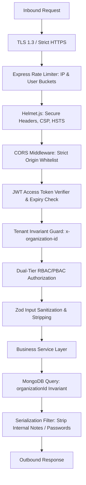

# TaskFlow Security & Quality Assurance Architecture Specification

- **Document Version**: v1.0 (Approved Baseline)
- **Status**: Approved & Baseline Locked
- **Date**: 2026-11-18
- **Project Directory**: `_bmad-output/planning-artifacts/security_qa`

---

## 1. Enterprise Security Checklist & OWASP Top 10 Mitigation

TaskFlow adheres to strict defense-in-depth principles across transport, authentication, tenant boundaries, and database query layers.



### 1.1 Detailed Security Defense Matrix

| Vulnerability Domain | Threat Vector | Technical Mitigation in TaskFlow |
| :--- | :--- | :--- |
| **Multi-Tenant Leakage** | IDOR / Object tampering (e.g. requesting `GET /tasks/:id` belonging to a foreign tenant). | Architectural invariant: All Mongoose queries mandate `{ organizationId: req.org._id }`. Foreign IDs return safe `404 Not Found`. Zero cross-tenant data leaks. |
| **Authentication & Session** | Token theft, replay attacks, session fixation. | 15-minute short-lived JWT access tokens + rotating 7-day refresh tokens stored in hashed format in `UserSessions` and delivered strictly via `HttpOnly; Secure; SameSite=Strict` cookies. |
| **Password Security** | Credential stuffing, brute-force dictionary attacks. | Bcrypt hashing with cost factor 12. Rate limiting on `/auth/login` (5 attempts / min per IP) with automated account lockout after 5 consecutive failures. |
| **Injection Attacks** | NoSQL query injection, operator tampering (`$gt`, `$ne`). | Zod schema validation strictly strips unknown fields and validates primitives. MongoDB queries utilize strongly-typed Mongoose models without raw string concatenations. |
| **Cross-Site Scripting (XSS)** | Malicious HTML / scripts injected via task descriptions or comments. | Markdown content sanitized via DOMPurify before rendering. Strict Content Security Policy (CSP) headers applied via Helmet.js. |
| **Comment Privacy Leakage** | Guests or external clients intercepting internal team notes. | Backend serialization middleware dynamically filters out comments where `isInternal: true` whenever the requesting user is an `Org Guest` or `Project Viewer`. |
| **File Upload Vulnerabilities** | Executable file uploads (`.exe`, `.sh`), server memory starvation. | Direct-to-Cloudinary signed uploads. Strict MIME whitelist (PDF, PNG, JPG, ZIP). Node.js server never buffers binary streams in process memory. |
| **Sensitive Data Exposure** | Password hashes or secrets leaked in stack traces or API responses. | Custom Mongoose `toJSON` transforms delete `passwordHash` and internal version keys. Production error handler returns standardized `{ code, message }` without stack traces. |

---

## 2. Comprehensive Quality Assurance & Testing Strategy

TaskFlow implements an automated testing pyramid combining unit, integration, and end-to-end suites.

```
       / \
      / E2E \       Playwright: Full multi-user Kanban drag & timer sync (15% coverage)
     /-------\
    /  Integ  \     Supertest + MongoMemoryServer: REST APIs & RBAC (35% coverage)
   /-----------\
  /    Unit     \   Vitest: LexoRank, cycle detection, schemas, stores (50% coverage)
 /---------------\
```

### 2.1 Unit Testing Strategy (Vitest)
- **Target Coverage**: >= 85% on pure utility functions and business domain logic.
- **Critical Test Suites**:
  1. `lexorank.spec.ts`: Validates midpoint calculations, edge gaps, alphanumeric ordering, and rebalancing thresholds.
  2. `cycleDetector.spec.ts`: Depth-first search tests proving circular dependencies are correctly caught and rejected.
  3. `timerStore.spec.ts`: Zustand client store tests verifying timer start/stop/resume and tick counter arithmetic.
  4. `schemaValidation.spec.ts`: Zod schema validation tests checking boundary conditions (negative durations, email formatting).

### 2.2 API Integration Testing Strategy (Vitest + Supertest + MongoMemoryServer)
- **Isolated In-Memory Databases**: Every test run boots an ephemeral in-memory MongoDB instance with transaction support.
- **Mandatory Test Matrix**:
  1. *Multi-Tenant Data Isolation Suite*: Proves that User A from Organization 1 cannot read, edit, or delete projects/tasks belonging to Organization 2, returning HTTP `404 Not Found`.
  2. *Dual-Tier RBAC/PBAC Matrix Suite*: Validates that `Project Member` cannot edit project settings, `Guest` cannot upload files or see internal comments, and only `Org Owner` can execute subscription plan changes.
  3. *Single-Active-Timer Concurrency Suite*: Executes concurrent `POST /time-tracking/timer/start` requests, verifying the database unique index on `userId` rejects or commits overlapping sessions deterministically.
  4. *Plan Quota Enforcement Suite*: Tests that Free organizations hitting 3 projects or 5 members receive HTTP `402 Payment Required` on subsequent creation attempts.

### 2.3 End-to-End (E2E) Testing Strategy (Playwright)
- **Multi-Context Browser Simulation**: Tests real-time interactions across two simultaneously connected browser sessions:
  1. *Real-Time Kanban Sync Test*:
     - User A (Team Lead) drags Card 1 from "To Do" to "In Progress".
     - Validates that User B (Developer) sees Card 1 smoothly transition to "In Progress" in < 100ms via Socket.IO without refreshing the page.
  2. *Active Stopwatch Timer Multi-Device Test*:
     - User starts a timer on desktop; logs into mobile session.
     - Verifies top navbar stopwatch widget ticks in lockstep and stopping timer commits an identical `TimeEntry` record.
  3. *Graceful Downgrade E2E Flow*:
     - Simulates an Org Owner downgrading from Pro to Free.
     - Selects 3 active projects; verifies remaining projects immediately enter read-only archive mode for all members.

### 2.4 Performance & Scalability Testing
- **K6 Load Testing Scenarios**:
  - Target: 100 concurrent virtual users executing authenticated task CRUD and Kanban reordering.
  - Acceptance Gate: p95 API response time must remain **< 150ms** with zero dropped Socket.IO connections.
