# TaskFlow End-to-End Workflow Master Architecture & Operations Manual

- **Document Version**: v2.0 (Complete System Flow Architecture)
- **Status**: Production Baseline
- **Date**: 2026-11-18
- **Project Scope**: Multi-Tenant B2B Engineering & Project Execution Platform
- **Deployment Topology**: React 19 Frontend + Node.js Express 5 Backend + Socket.IO Engine + MongoDB Atlas

---

## Table of Contents
1. Executive System Summary & Architectural Principles
2. Tenant Lifecycle & Multi-Tier Identity Onboarding Flow
3. Project Initialization, Issue Taxonomy & Auto-Increment Logic
4. Sprint Planning, Backlog Refinement & Milestone Scheduling Flow
5. Real-Time Kanban Execution & LexoRank Optimistic Concurrency Engine
6. Task Details Lifecycle, Subtasks, Attachments & Context Drawer
7. Contextual Real-Time Collaboration & Zero-Leak Comment Engine
8. Native Time Tracking, Active Stopwatch Lock & Timesheet Aggregation Flow
9. Directed Dependency Graph & Depth-First Search Cycle Prevention Engine
10. Sprint Analytics, Velocity Aggregation & Burndown Pipelines
11. Organization Administration, RBAC/PBAC Governance & Audit Logging Engine
12. Super Admin Control Plane, Real-Time Disconnect & Tenant Suspension Flow
13. Comprehensive Data Dictionary & 21 Collections Schema Invariants
14. Complete REST API Specifications & Error Contract Matrix
15. Socket.IO Room Topology & Event Dispatch Protocol
16. Disaster Recovery, Production Verification & Runbook Checklist

---

## 1. Executive System Summary & Architectural Principles

TaskFlow is designed as a **Modular Monolith** optimized for enterprise software squads, high-throughput sprint execution, and multi-tenant isolation. Commercial, paywall, and subscription friction have been removed to prioritize continuous software delivery, zero-latency state synchronization, and strict data governance.

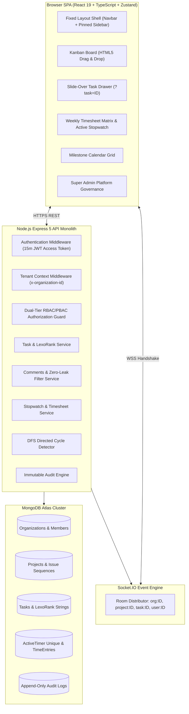

### 1.1 Invariant Architectural Pillars
1. **Strict Multi-Tenant Scoping**: No entity is ever retrieved, modified, or streamed without an explicit `{ organizationId: req.org._id }` query condition.
2. **Single-Active-Timer Constraint**: An engineer can only run a single active stopwatch timer across all devices. Starting a timer on any device automatically flushes the existing timer into permanent history.
3. **Optimistic LexoRank Concurrency**: Reordering kanban cards requires an atomic version check (`version: input.version`), rejecting collisions with HTTP `409 ORDER_CONFLICT` instead of performing destructive overwrites.
4. **Zero-Leak Comment Privacy Filter**: Internal discussions (`isInternal: true`) are systematically stripped from serialization pipelines whenever accessed by users with the `guest` organization role.
5. **DAG Graph Verification**: Task dependencies are maintained as a directed acyclic graph (DAG). Adding any dependency triggers a Depth-First Search (DFS) algorithm that rejects circular dependency loops with HTTP `400 CIRCULAR_DEPENDENCY_DETECTED`.

---

## 2. Tenant Lifecycle & Multi-Tier Identity Onboarding Flow

Every transaction in TaskFlow occurs within an isolated organization boundary. The lifecycle begins with global registration and tenant establishment.

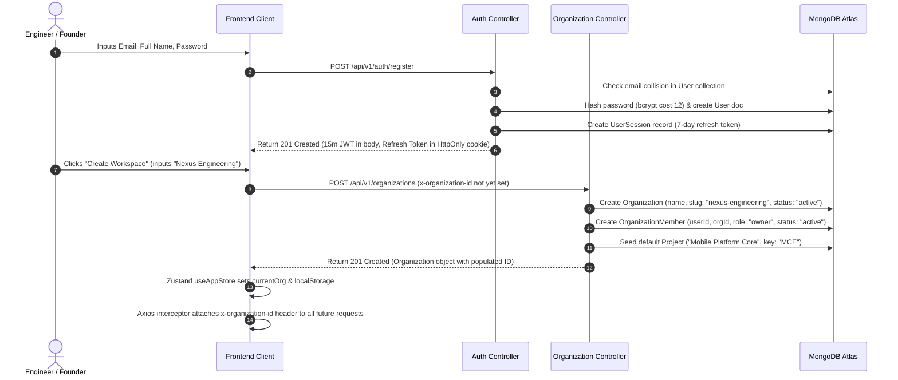

### Step-by-Step State Transitions:
1. **Unauthenticated State**: User lands on `/login` or `/register`. No tenant cookie or access tokens exist.
2. **Global User Registration**: A document is inserted into the `users` collection:
   ```json
   {
     "_id": "6afd42f398491b4d9c8da07b",
     "email": "alex.morgan@nexus.io",
     "fullName": "Alex Morgan",
     "passwordHash": "$2b$12$e8YkZ...Hq1",
     "status": "active",
     "isSuperAdmin": false,
     "createdAt": "2026-11-18T06:00:00.000Z"
   }
   ```
3. **Session Establishment**: A `user_sessions` document is generated with cryptographic hash of the refresh token. The client receives `accessToken` in the JSON envelope and `refreshToken` in a strict cookie:
   `Set-Cookie: refreshToken=...; HttpOnly; Secure; SameSite=Strict; Path=/api/v1/auth; Max-Age=604800`
4. **Tenant Context Attachment**: As soon as an organization is created or selected:
   - The frontend store updates `currentOrg: { id: "6afd42f398491b4d9c8da07c", name: "Nexus Engineering", role: "owner" }`.
   - The top navigation bar displays the organization switcher pill.
   - Every outgoing HTTP request appends the header: `x-organization-id: 6afd42f398491b4d9c8da07c`.

---

## 3. Project Initialization, Issue Taxonomy & Auto-Increment Logic

Projects serve as the operational containers for tasks, columns, and sprint delivery milestones.

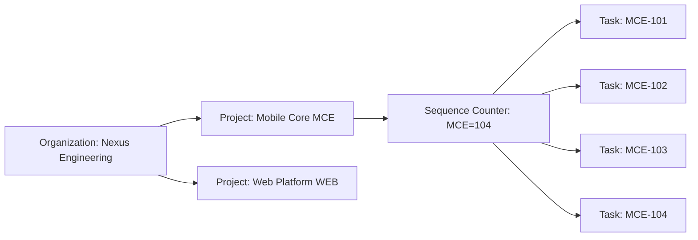

### 3.1 Project Schema Invariants
- Each project possesses a unique uppercase key within its organization (2 to 10 alphanumeric characters, e.g. `MCE`, `CORE`, `API`).
- The project defines default workflow column definitions:
  - `backlog`: Order 0, Backlog
  - `todo`: Order 1, To Do
  - `in_progress`: Order 2, In Progress (with optional `wipLimit: 4`)
  - `review`: Order 3, In Review
  - `done`: Order 4, Done
- Issue keys are generated via an atomic MongoDB sequence counter:
  ```typescript
  const sequence = await ProjectSequence.findOneAndUpdate(
    { organizationId: orgId, projectId: project._id },
    { $inc: { currentSequence: 1 } },
    { upsert: true, new: true }
  );
  const taskKey = `${project.key}-${sequence.currentSequence}`; // e.g. MCE-105
  ```

---

## 4. Sprint Planning, Backlog Refinement & Milestone Scheduling Flow

Sprint planning enables leads and engineers to prioritize deliverables and commit scopes into milestones.

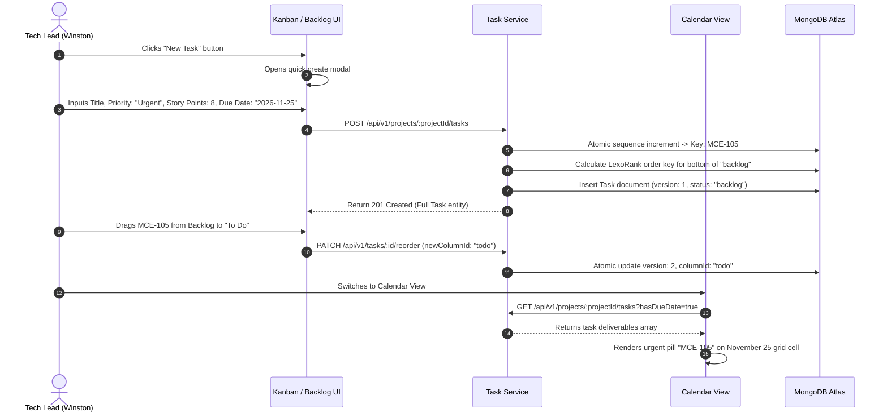

---

## 5. Real-Time Kanban Execution & LexoRank Optimistic Concurrency Engine

The Kanban board is the central operational interface. Drag-and-drop card movements must be instantaneous for the active user while updating all team members across the network in under 100 milliseconds.

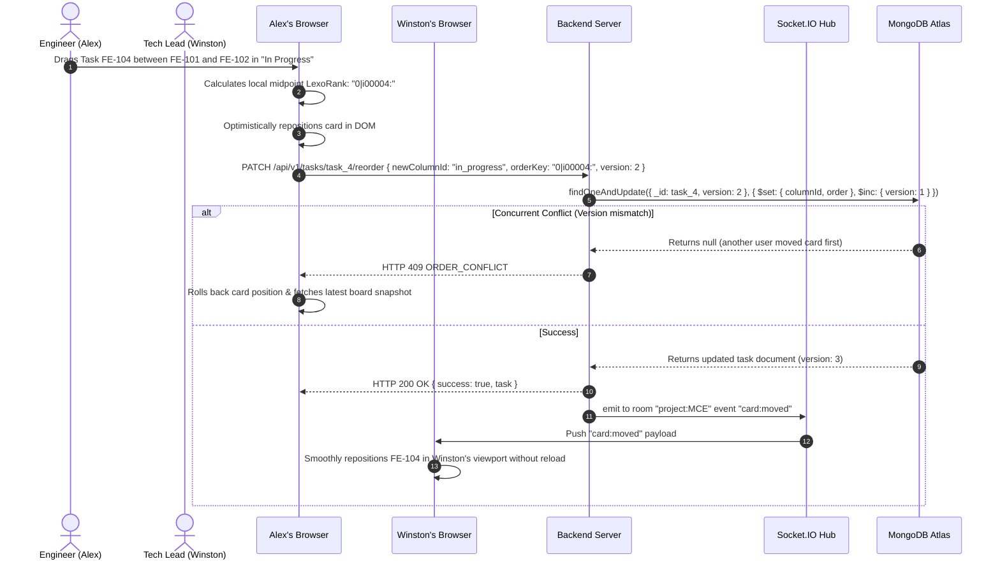

### 5.1 LexoRank Calculation Algorithm
Instead of re-indexing every card in an array on every movement (which causes $O(N)$ writes and database locking), LexoRank assigns alphanumeric string ranks:
1. Card A has rank `0|i00000:`
2. Card B has rank `0|i00008:`
3. Inserting between Card A and Card B produces midpoint `0|i00004:`
4. Inserting between Card A and the new midpoint produces `0|i00002:`
5. When characters exhaust string gap intervals, a sub-rank bucket character is appended (e.g. `0|i00002m:`), allowing infinite insertions without full column rewrites.

---

## 6. Task Details Lifecycle, Subtasks, Attachments & Context Drawer

When an engineer inspects a task, clicking the card opens the **Task Details Slide-Over Drawer** without navigating away from the board.

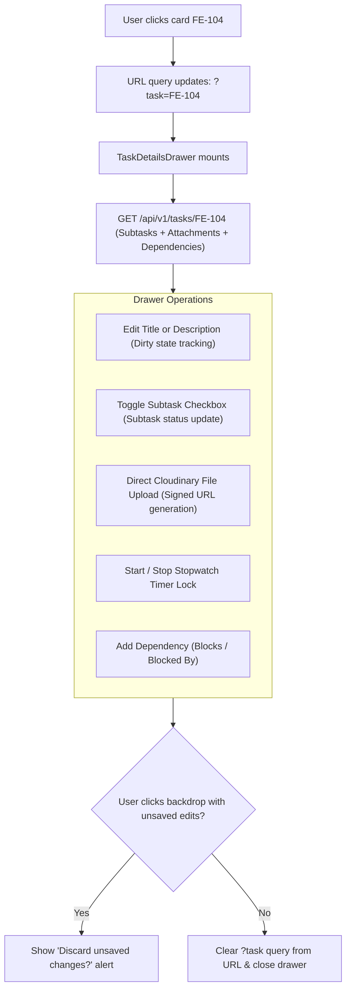

### 6.1 Direct Signed File Upload Architecture
1. Client requests upload signature: `POST /api/v1/tasks/:taskId/attachments/sign`
2. Backend validates:
   - File size under 10 megabytes
   - MIME type matches whitelist (`image/png`, `image/jpeg`, `application/pdf`, `text/plain`, `application/zip`)
   - User has member or admin permissions (guests rejected with 403)
3. Backend generates SHA-256 HMAC timestamp signature.
4. Client uploads binary directly to Cloudinary edge storage via HTTPS PUT.
5. Client notifies backend: `POST /api/v1/tasks/:taskId/attachments/complete` with file URL, byte size, and hash.
6. Backend persists `TaskAttachment` document and emits `attachment:added` to `task:<id>` room.

---

## 7. Contextual Real-Time Collaboration & Zero-Leak Comment Engine

Comments facilitate contextual technical discussion on tasks. The **Zero-Leak Comment Privacy Filter** guarantees that internal team discussions remain private from external contractors and guests.

```mermaid
sequenceDiagram
    autonumber
    actor Owner as Org Owner (Alex)
    actor Guest as External Contractor (Bob)
    participant API as Comment Controller
    participant Svc as Comment Service
    participant DB as MongoDB Atlas

    Owner->>API: POST /api/v1/tasks/FE-104/comments { text: "Public sprint milestone update", isInternal: false }
    API->>Svc: createComment(orgId, taskId, authorId, "owner", input)
    Svc->>DB: Save TaskComment doc (isInternal: false)
    Svc-->>Owner: 201 Created

    Owner->>API: POST /api/v1/tasks/FE-104/comments { text: "CONFIDENTIAL: Architecture technical debt", isInternal: true }
    API->>Svc: createComment(orgId, taskId, authorId, "owner", input)
    Svc->>DB: Save TaskComment doc (isInternal: true)
    Svc-->>Owner: 201 Created

    Note over Guest,DB: Guest Requests Comments List
    Guest->>API: GET /api/v1/tasks/FE-104/comments (Auth header + x-org-id)
    API->>Svc: listComments(orgId, taskId, isGuest: true)
    Svc->>DB: find({ organizationId: orgId, taskId, isInternal: false })
    DB-->>Svc: Returns ONLY public comment
    Svc-->>Guest: 200 OK (Public comment only; confidential comment omitted)

    Note over Owner,DB: Owner Requests Comments List
    Owner->>API: GET /api/v1/tasks/FE-104/comments
    API->>Svc: listComments(orgId, taskId, isGuest: false)
    Svc->>DB: find({ organizationId: orgId, taskId })
    DB-->>Svc: Returns BOTH public and internal comments
    Svc-->>Owner: 200 OK (Both comments visible with internal badge)
```

---

## 8. Native Time Tracking, Active Stopwatch Lock & Timesheet Aggregation Flow

Engineers track hours through a real-time stopwatch widget in the navigation bar or manual timesheet entries.

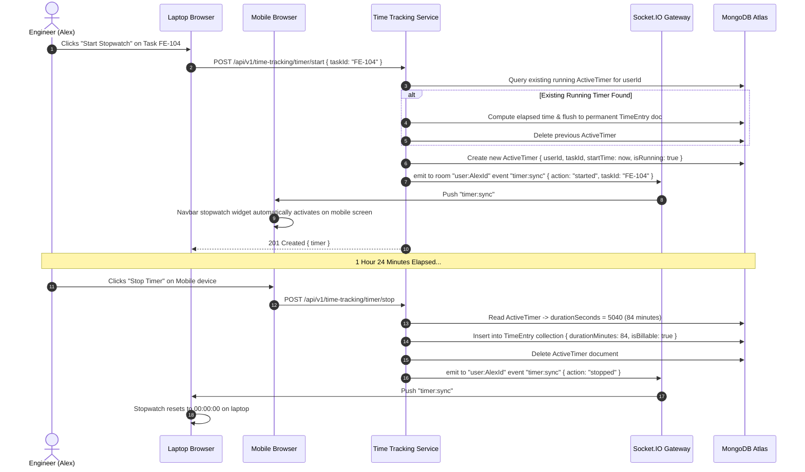

---

## 9. Directed Dependency Graph & Depth-First Search Cycle Prevention Engine

Tasks often depend on deliverables from other tasks. TaskFlow supports dependency types (`blocks`, `blocked_by`, `relates_to`). To prevent deadlocks, a Depth-First Search (DFS) graph traversal executes prior to every dependency insertion.

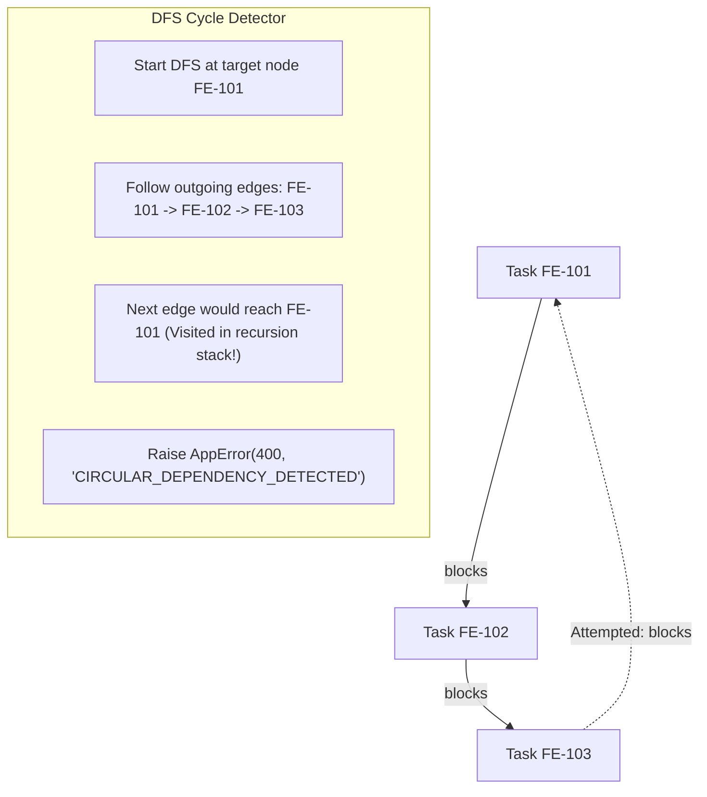

### Cycle Detection Algorithm Implementation:
```typescript
export async function detectCycle(
  orgId: string, 
  sourceTaskId: string, 
  targetTaskId: string
): Promise<boolean> {
  // If target points directly to source, immediate 1-hop cycle
  if (sourceTaskId === targetTaskId) return true;

  const visited = new Set<string>();
  const recursionStack = new Set<string>();

  async function dfs(currentId: string): Promise<boolean> {
    visited.add(currentId);
    recursionStack.add(currentId);

    // Fetch all tasks that currentId blocks
    const dependencies = await TaskDependency.find({
      organizationId: orgId,
      sourceTaskId: currentId,
      type: 'blocks',
    });

    for (const dep of dependencies) {
      const neighborId = dep.targetTaskId.toString();
      if (neighborId === sourceTaskId) {
        return true; // Cycle detected: path leads back to proposed source
      }
      if (!visited.has(neighborId)) {
        if (await dfs(neighborId)) return true;
      } else if (recursionStack.has(neighborId)) {
        return true;
      }
    }

    recursionStack.delete(currentId);
    return false;
  }

  return dfs(targetTaskId);
}
```

---

## 10. Sprint Analytics, Velocity Aggregation & Burndown Pipelines

The **Sprint Analytics** view provides real-time visibility into engineering velocity, cycle time distributions, and billable hour ratios using MongoDB aggregation pipelines.

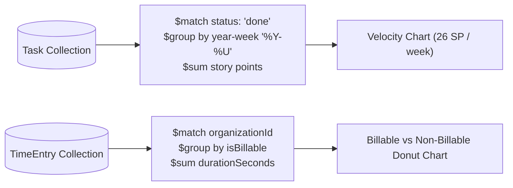

### 10.1 Aggregation Pipeline Definitions:
- **Weekly Completed Velocity**:
  ```javascript
  [
    { $match: { organizationId: orgId, status: "done" } },
    { $group: {
        _id: { $dateToString: { format: "%Y-%U", date: "$updatedAt" } },
        completedPoints: { $sum: "$storyPoints" },
        taskCount: { $sum: 1 }
    }},
    { $sort: { _id: 1 } }
  ]
  ```
- **Billable Ratio Breakdown**:
  ```javascript
  [
    { $match: { organizationId: orgId } },
    { $group: {
        _id: "$isBillable",
        totalSeconds: { $sum: "$durationSeconds" },
        logCount: { $sum: 1 }
    }}
  ]
  ```

---

## 11. Organization Administration, RBAC/PBAC Governance & Audit Logging Engine

Administrative operations (invitations, role promotions, project deletions) generate immutable audit records.

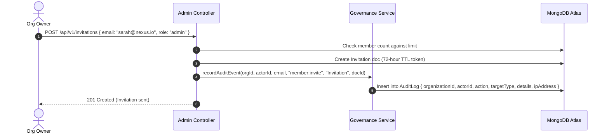

### 11.1 Audit Log Schema Properties:
- `organizationId`: Indexed ObjectId scoping the audit event to the tenant.
- `actorId`: ObjectId of the user who performed the operation.
- `actorEmail`: Email address recorded at event time for quick administrative review.
- `action`: Normalized dot-separated string (e.g. `project:create`, `member:role_change`, `task:delete`).
- `targetType`: Entity collection modified (`Project`, `User`, `Task`, `Organization`).
- `details`: JSON payload preserving old vs. new values.
- `createdAt`: Immutable timestamp (updates disabled on collection).

---

## 12. Super Admin Control Plane, Real-Time Disconnect & Tenant Suspension Flow

Platform root administrators access the `/admin-portal` to monitor platform telemetry and take compliance enforcement actions.

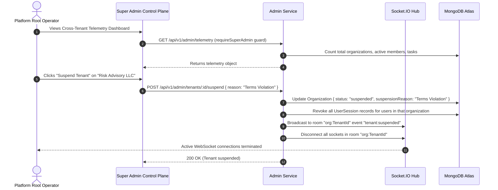

---

## 13. Comprehensive Data Dictionary & 21 Collections Schema Invariants

TaskFlow operates on 21 schema collections in MongoDB:

| # | Collection Name | Primary Identifier | Discriminator / Foreign Keys | Indexes & Constraints |
|---|---|---|---|---|
| 1 | `users` | `_id` (ObjectId) | None | `{ email: 1 }` (unique), `{ isSuperAdmin: 1 }` |
| 2 | `user_sessions` | `_id` (ObjectId) | `userId` &rarr; `users._id` | `{ refreshTokenHash: 1 }`, `{ expiresAt: 1 }` (TTL) |
| 3 | `organizations` | `_id` (ObjectId) | `ownerId` &rarr; `users._id` | `{ slug: 1 }` (unique), `{ status: 1 }` |
| 4 | `organization_members` | `_id` (ObjectId) | `organizationId`, `userId` | `{ organizationId: 1, userId: 1 }` (unique) |
| 5 | `invitations` | `_id` (ObjectId) | `organizationId`, `invitedBy` | `{ token: 1 }` (unique), `{ expiresAt: 1 }` (72h TTL) |
| 6 | `projects` | `_id` (ObjectId) | `organizationId`, `leadId` | `{ organizationId: 1, key: 1 }` (unique) |
| 7 | `project_members` | `_id` (ObjectId) | `projectId`, `userId` | `{ projectId: 1, userId: 1 }` (unique) |
| 8 | `project_sequences` | `_id` (ObjectId) | `organizationId`, `projectId` | `{ organizationId: 1, projectId: 1 }` (unique) |
| 9 | `tasks` | `_id` (ObjectId) | `organizationId`, `projectId`, `assigneeId` | `{ organizationId: 1, projectId: 1, order: 1 }`, `{ version: 1 }` |
| 10 | `task_subtasks` | `_id` (ObjectId) | `taskId`, `assigneeId` | `{ taskId: 1, order: 1 }` |
| 11 | `task_comments` | `_id` (ObjectId) | `organizationId`, `taskId`, `authorId` | `{ organizationId: 1, taskId: 1, isInternal: 1 }` |
| 12 | `task_attachments` | `_id` (ObjectId) | `organizationId`, `taskId`, `uploadedBy` | `{ organizationId: 1, taskId: 1 }` |
| 13 | `task_dependencies` | `_id` (ObjectId) | `organizationId`, `sourceTaskId`, `targetTaskId` | `{ organizationId: 1, sourceTaskId: 1, targetTaskId: 1 }` (unique) |
| 14 | `active_timers` | `_id` (ObjectId) | `organizationId`, `userId`, `taskId` | `{ userId: 1, isRunning: 1 }` (unique lock) |
| 15 | `time_entries` | `_id` (ObjectId) | `organizationId`, `projectId`, `taskId`, `userId` | `{ organizationId: 1, userId: 1, date: -1 }` |
| 16 | `audit_logs` | `_id` (ObjectId) | `organizationId`, `actorId` | `{ organizationId: 1, createdAt: -1 }` |
| 17 | `milestones` | `_id` (ObjectId) | `organizationId`, `projectId` | `{ projectId: 1, dueDate: 1 }` |
| 18 | `custom_roles` | `_id` (ObjectId) | `organizationId` | `{ organizationId: 1, name: 1 }` (unique) |
| 19 | `notifications` | `_id` (ObjectId) | `organizationId`, `userId` | `{ userId: 1, isRead: 1 }` |
| 20 | `user_presence` | `_id` (ObjectId) | `organizationId`, `userId` | `{ userId: 1, lastSeen: 1 }` (heartbeat) |
| 21 | `system_telemetry` | `_id` (ObjectId) | None | `{ timestamp: -1 }` |

---

## 14. Complete REST API Specifications & Error Contract Matrix

All API endpoints follow a consistent JSON response envelope:
```json
{
  "success": true,
  "data": { ... },
  "meta": {
    "timestamp": "2026-11-18T06:50:00.000Z",
    "requestId": "req_818294a"
  }
}
```

### 14.1 Standard Error Envelope
```json
{
  "success": false,
  "error": {
    "code": "ORDER_CONFLICT",
    "message": "Concurrent card movement detected. The board has been updated by another action.",
    "statusCode": 409
  },
  "meta": {
    "timestamp": "2026-11-18T06:50:00.000Z"
  }
}
```

### 14.2 HTTP Status & Error Code Catalog:
- `400 BAD_REQUEST`: Zod schema validation failure or malformed payload.
- `400 CIRCULAR_DEPENDENCY_DETECTED`: DFS cycle detector identified a circular task loop.
- `401 UNAUTHORIZED`: Missing, expired, or malformed JWT access token.
- `403 FORBIDDEN`: Insufficient role level (e.g. guest attempting to invite members).
- `403 ORGANIZATION_SUSPENDED`: Workspace access blocked by root operator.
- `404 NOT_FOUND`: Entity not found within the active tenant boundary.
- `409 EMAIL_ALREADY_EXISTS`: Global registration conflict on duplicate email address.
- `409 ORDER_CONFLICT`: Optimistic concurrency lock collision on LexoRank update.
- `500 INTERNAL_SERVER_ERROR`: Unhandled exception caught by centralized error handler.

---

## 15. Socket.IO Room Topology & Event Dispatch Protocol

Socket.IO connections require authenticated JWT handshakes. Upon connection, the socket joins authorized rooms:

```
Socket Connection
 ├── Room: "user:<userId>"           (Personal timer sync & direct alerts)
 ├── Room: "org:<orgId>"             (Workspace presence & tenant lifecycle)
 ├── Room: "project:<projectId>"     (Kanban card movement & issue creation)
 └── Room: "task:<taskId>"           (Real-time comments & live presence)
```

### 15.1 Real-Time Event Catalog:
| Event Name | Room Scope | Direction | Payload Structure |
|---|---|---|---|
| `card:moved` | `project:<id>` | Server &rarr; Client | `{ taskId, newColumnId, orderKey, version }` |
| `task:created` | `project:<id>` | Server &rarr; Client | `{ task: TaskItem }` |
| `comment:added` | `task:<id>` | Server &rarr; Client | `{ comment: CommentItem }` (Filtered for guests) |
| `timer:sync` | `user:<id>` | Server &rarr; Client | `{ action: 'started' \| 'stopped', taskId, timeEntry }` |
| `tenant:suspended` | `org:<id>` | Server &rarr; Client | `{ organizationId, reason }` |

---

## 16. Disaster Recovery, Production Verification & Runbook Checklist

### 16.1 Developer Verification Runbook
To verify end-to-end platform integrity on any fresh installation:

```bash
# 1. Start MongoDB connection & Backend Monolith
cd backend
npm install
npm run build
npx tsx src/server.ts

# 2. Run Comprehensive Automated Test Suite
# Tests Registration -> Multi-Tenant Isolation -> LexoRank -> Zero-Leak Comments -> DFS Cycle Lock
npx tsx test-governance.ts

# 3. Start Frontend Client SPA
cd ../frontend
npm install
npm run build
npm run dev
```

### 16.2 Production Healthcheck Verification
Query the health check endpoint to confirm operational status:
```bash
curl http://localhost:5000/api/v1/health
# Expects: {"success":true,"data":{"status":"healthy","service":"TaskFlow Modular Monolith API"}}
```
