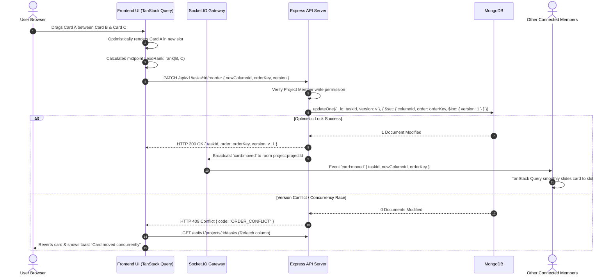
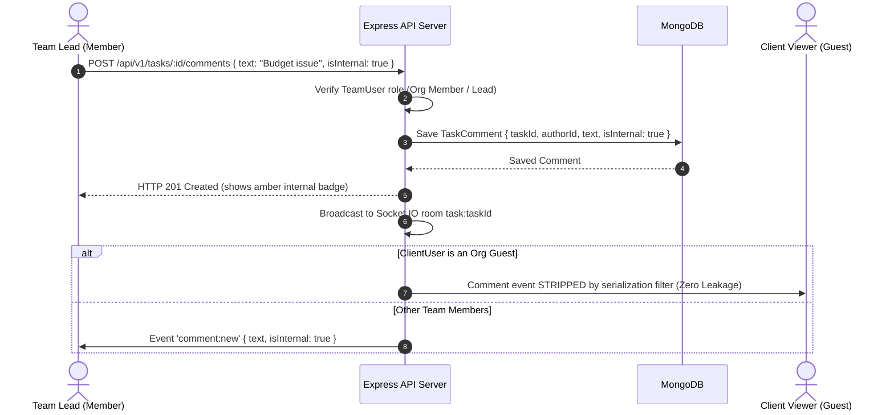
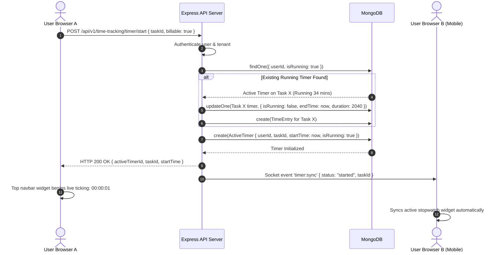

# TaskFlow Application Workflows & State Machine Specifications

- **Document Version**: v1.0 (Approved Baseline)
- **Status**: Approved & Baseline Locked
- **Date**: 2026-11-18
- **Project Directory**: `_bmad-output/planning-artifacts/workflows`

---

## 1. Global Workflow Architectural Conventions

Every workflow in TaskFlow strictly complies with the following architecture:
1. **Tenant Enclosure**: All API requests validate active session token and `x-organization-id` header. Mutating operations inject `organizationId: req.org._id` into all database operations.
2. **Dual-Tier Permission Verification**:
   - Organization workflows check Tier 1 roles (`Org Owner`, `Org Admin`, `Org Member`, `Org Guest`).
   - Project workflows check Tier 2 roles (`Project Manager`, `Team Lead`, `Project Member`, `Guest / Viewer`).
3. **Optimistic UI & Cache Revalidation**: Frontend TanStack Query applies optimistic local mutations, rolling back on API error.
4. **Real-Time Side Effects**: Backend dispatches atomic events via Socket.IO rooms (`org:<id>`, `project:<id>`, `task:<id>`).

---

## 2. Complete Specifications for 20 Primary Application Workflows

---

### Workflow 1: User Registration, Session Creation & JWT Refresh Cycle
- **Starting Condition**: Unauthenticated user visits `/register`.
- **User Action**: Enters Email, Full Name, and Password; submits form.
- **Frontend Behavior**:
  - Validates fields via Zod client schema.
  - POSTs payload to `/api/v1/auth/register`. Shows loading spinner.
- **Backend Processing**:
  - Verifies email uniqueness in `Users` collection.
  - Hashes password using bcrypt (cost factor 12).
  - Creates user record with `status: "active"`, `isSuperAdmin: false`.
  - Generates 15-minute access token (JWT) and cryptographically random 7-day refresh token.
  - Stores hashed refresh token in `UserSessions` collection.
  - Sets refresh token as `HttpOnly; Secure; SameSite=Strict` cookie; returns access token in JSON body.
- **Success Response**: HTTP `201 Created` with `{ user, accessToken }`.
- **Error Scenarios**:
  - Email conflict &rarr; HTTP `409 Conflict` (`EMAIL_ALREADY_EXISTS`).
  - Weak password &rarr; HTTP `422 Unprocessable Entity`.
- **Side Effects**: System dispatches welcome email event to message queue; user redirected to `/onboarding/create-org`.

---

### Workflow 2: Organization Creation & Initial Workspace Setup
- **Starting Condition**: Authenticated user with no organizations or selecting "Create Workspace" from switcher.
- **User Action**: Enters Organization Name (e.g., "Acme Engineering"), optional logo, and selects Plan ("Free").
- **Frontend Behavior**: Validates slug availability in real time; submits to `/api/v1/organizations`.
- **Backend Processing**:
  - Runs in a **MongoDB multi-document transaction**:
    1. Creates `Organization` document (`status: "active"`).
    2. Creates `OrganizationMember` document linking User & Org with role `Org Owner`.
    3. Provisions initial `OrganizationSubscription` with `plan: "free"`, `status: "active"`.
    4. Seeds default project ("Welcome Project") and default Kanban columns (`Backlog`, `To Do`, `In Progress`, `Review`, `Done`).
- **Success Response**: HTTP `201 Created` with organization payload.
- **Side Effects**: Frontend adds new organization to Zustand workspace switcher and redirects user to `/dashboard`.

---

### Workflow 3: Organization Member Invitations & Quota Guarding
- **Starting Condition**: Org Owner or Org Admin on `/team` page.
- **User Action**: Clicks "Invite Member", enters recipient email and selects Role (`Org Admin`, `Org Member`, `Org Guest`).
- **Frontend Behavior**: Validates email format; checks current member count against sidebar quota meter.
- **Backend Processing**:
  - Verifies requesting user is `Org Owner` or `Org Admin`.
  - Checks organization plan limits:
    $$\text{Active Members} + \text{Pending Invitations} < \text{Plan Member Quota}$$
  - If limit reached (e.g. 5 members on Free tier), aborts with HTTP `402 Payment Required` (`MEMBER_QUOTA_EXCEEDED`).
  - Generates signed, tamper-proof invitation token (72-hour TTL) in `Invitations` collection.
  - Sends invitation email containing secure signup/acceptance link.
- **Success Response**: HTTP `201 Created` with sanitized invitation summary.
- **Error Scenarios**: User already an active member &rarr; HTTP `400 Bad Request`.

---

### Workflow 4: Invitation Acceptance & Multi-Tenant Onboarding
- **Starting Condition**: Invited user clicks link (`/invite/accept?token=TOKEN`).
- **User Action**: Clicks "Accept Invitation" (or enters password if a new user).
- **Backend Processing**:
  - Validates token authenticity, expiration, and organization status.
  - Runs in a MongoDB transaction:
    1. Upserts `User` document.
    2. Creates `OrganizationMember` record for the target organization with specified role.
    3. Marks invitation status as `accepted`.
    4. Automatically adds member to pre-assigned projects.
- **Success Response**: HTTP `200 OK` with auth session and workspace context.
- **Side Effects**: Emits Socket.IO event `member:joined` to room `org:<orgId>`. Team directory updates in real-time.

---

### Workflow 5: Role Assignment & Permission Updates
- **Starting Condition**: Org Owner or Admin on `/team` screen.
- **User Action**: Selects a member and changes role (e.g. `Org Member` &rarr; `Org Admin`).
- **Backend Processing**:
  - Ensures requester has equal or higher authority (Org Admin cannot change role of Org Owner).
  - Updates `OrganizationMember.role`.
  - Records event in `ActivityLogs` and `AuditLogs` (Business tier).
- **Success Response**: HTTP `200 OK`.
- **Side Effects**: Dispatches Socket.IO `member:role_updated` to target user session. Target client's TanStack Query refreshes user claims without logout.

---

### Workflow 6: Project Creation & Plan Quota Enforcement
- **Starting Condition**: Authenticated member on `/projects` page.
- **User Action**: Clicks "New Project", enters title ("Mobile App v2"), description, and target completion date.
- **Backend Processing**:
  - Verifies organization quota:
    $$\text{Count}(\text{Projects with status: "active"}) < \text{Plan Project Quota}$$
  - On Free tier, if active projects >= 3, rejects with HTTP `402 Payment Required` (`PROJECT_QUOTA_EXCEEDED`).
  - Creates `Project` document (`organizationId: req.org._id`, `status: "active"`).
  - Creates default `ProjectMember` record setting creator as `Project Manager`.
  - Seeds project Kanban columns.
- **Success Response**: HTTP `201 Created` with project details.
- **Side Effects**: Emits Socket.IO `project:created` to `org:<orgId>`. Project list in sidebar updates automatically.

---

### Workflow 7: Project Member Assignment & Access Control
- **Starting Condition**: Project Manager on `/projects/:id/settings`.
- **User Action**: Adds organization member to project, assigning Tier 2 role (`Team Lead`, `Project Member`, `Guest / Viewer`).
- **Backend Processing**:
  - Verifies target user is an active member of the organization.
  - If user is an `Org Guest`, forces Tier 2 role to `Guest / Viewer`.
  - Creates or updates `ProjectMember` record.
- **Success Response**: HTTP `200 OK`.
- **Side Effects**: Emits notification to invited user; user gains visibility into project in navigation tree.

---

### Workflow 8: Task Creation & Initial Assignment
- **Starting Condition**: Project member on Kanban, List, or via `Ctrl+K`.
- **User Action**: Enters Task Title, Assignee, Priority (`High`), Due Date; clicks "Create Task".
- **Backend Processing**:
  - Verifies project membership and write permissions.
  - Calculates initial `order` string (LexoRank) for placement at top of column.
  - Generates human-readable task identifier (e.g., `ACME-108`).
  - Saves `Task` document.
- **Success Response**: HTTP `201 Created`.
- **Side Effects**: Dispatches Socket.IO `task:created` to `project:<projectId>`. If assigned to another user, pushes notification to `org:<orgId>`.

---

### Workflow 9: Task Status Transitions & Column Workflow Enforcement
- **Starting Condition**: Task in `In Progress` status.
- **User Action**: User changes status dropdown to `Review`.
- **Backend Processing**:
  - Checks if column WIP (Work In Progress) limit is exceeded.
  - Updates `Task.status` and `Task.columnId`.
  - Appends transition entry to `Task.history`.
- **Success Response**: HTTP `200 OK`.
- **Side Effects**: Emits Socket.IO `task:status_changed` to `project:<projectId>`. Kanban column counters update in real time.

---

### Workflow 10: Kanban Drag-and-Drop Ordering (LexoRank Algorithm)



- **Rebalancing Trigger**: When `orderKey` string length reaches 32 characters, an asynchronous background job re-indexes the column using evenly spaced keys (e.g. `0|i00000:`, `0|i00010:`).

---

### Workflow 11: Task Dependencies & Circular Loop Prevention
- **Starting Condition**: User editing task dependencies in Task Details Drawer.
- **User Action**: Adds Task B as predecessor to Task A ("Task A depends on Task B").
- **Backend Processing**:
  - Loads dependency graph for the project.
  - Performs depth-first search (DFS) cycle detection starting at Task B.
  - If a path exists from Task A &rarr; Task B, rejects with HTTP `400 Bad Request` (`CIRCULAR_DEPENDENCY_DETECTED`).
  - Otherwise, saves record in `TaskDependencies`.
- **Success Response**: HTTP `201 Created`.
- **Side Effects**: Timeline/Gantt view redraws dependency SVG connector.

---

### Workflow 12: Project Deadlines & Calendar Synchronization
- **Starting Condition**: User moves a task pill on Calendar view.
- **User Action**: Drags task from Nov 18 to Nov 22.
- **Backend Processing**:
  - Updates `Task.dueDate = "2026-11-22"`.
  - Checks if new due date violates predecessor milestone rules; returns warning metadata if at risk.
- **Success Response**: HTTP `200 OK`.
- **Side Effects**: Emits Socket.IO `task:updated` to `project:<projectId>`.

---

### Workflow 13: Comments, Mentions & Internal Privacy Filtering



---

### Workflow 14: Secure File Attachments Upload
- **Starting Condition**: Project member inside Task Details Drawer.
- **User Action**: Selects and uploads a file (e.g. `specs.pdf`, 4.2 MB).
- **Backend Processing**:
  - Rejects if user is an `Org Guest` (HTTP `403 Forbidden`).
  - Validates file MIME type against whitelist (Images, PDF, DOCX, ZIP); rejects executable extensions (`.exe`, `.sh`).
  - Enforces max file size (10 MB).
  - Streams file to Cloudinary / storage bucket with signed headers.
  - Saves file metadata in `TaskAttachments`.
- **Success Response**: HTTP `201 Created` with secure CDN URL.
- **Side Effects**: Dispatches Socket.IO `attachment:uploaded` to `task:<taskId>`.

---

### Workflow 15: Centralized Notifications & Real-Time Delivery
- **Starting Condition**: Any system trigger (user mentioned in comment, assigned to task, deadline approaching).
- **Backend Processing**:
  - Creates `Notification` document (`recipientId`, `senderId`, `type`, `targetUrl`, `isRead: false`).
  - Emits real-time Socket.IO event `notification:new` to recipient's private user channel `user:<userId>`.
- **Frontend Behavior**:
  - Increments unread counter on top navbar bell icon.
  - Plays subtle notification chime (if enabled in user settings).
  - Displays transient desktop/toast alert.

---

### Workflow 16: Active Stopwatch Timer & Concurrency Guarding



---

### Workflow 17: Timesheets, Aggregations & Productivity Reporting
- **Starting Condition**: Org Admin or Project Manager visiting `/reports`.
- **User Action**: Selects Date Range (Current Sprint) and clicks "Generate Report".
- **Backend Processing**:
  - Verifies Pro or Business plan entitlement.
  - Executes MongoDB aggregation pipeline:
    - Matches entries by `organizationId`, date range, and project filter.
    - Groups by `userId` and `projectId`.
    - Sums total hours and billable vs non-billable splits.
  - Redacts hourly rates if requesting user does not hold billing permissions.
- **Success Response**: HTTP `200 OK` with aggregated reporting datasets.
- **Frontend Behavior**: Renders velocity burndown charts and time distribution donut charts.

---

### Workflow 18: Subscription Upgrades & Simulated Payment Lifecycle
- **Starting Condition**: Org Owner on `/settings/billing`.
- **User Action**: Selects "Upgrade to Pro" ($12/user/mo), clicks "Confirm Simulated Upgrade".
- **Backend Processing**:
  - Strictly restricted to `Org Owner` (Org Admin receives HTTP `403 Forbidden`).
  - Runs in a MongoDB multi-document transaction:
    1. Generates `PaymentTransaction` document (`status: "simulated_success"`, `amount: seats * 12`, `gateway: "simulated"`).
    2. Updates `OrganizationSubscription` record to `plan: "pro"`, recalculates feature entitlements.
    3. Generates simulated invoice PDF metadata.
    4. Records entry in `AuditLogs`.
- **Success Response**: HTTP `200 OK` with updated subscription state.
- **Side Effects**: Real-time broadcast unlocks Pro features (Gantt, Active Timer, Reports) for all connected organization members immediately.

---

### Workflow 19: Graceful Subscription Downgrades & Read-Only Archival

```mermaid
sequenceDiagram
    autonumber
    actor Owner as Org Owner
    participant FE as Frontend UI
    participant API as Express API Server
    participant DB as MongoDB

    Owner->>FE: Selects "Downgrade to Free"
    FE->>API: GET /api/v1/billing/downgrade-preview
    API-->>FE: Return usage: 12 Projects (Max 3), 14 Members (Max 5)
    FE->>Owner: Displays Graceful Downgrade Modal
    Owner->>FE: Selects 3 Active Projects (A, B, C); submits
    FE->>API: POST /api/v1/billing/downgrade { targetPlan: "free", activeProjectIds: [A, B, C] }
    API->>API: Verify requester is Org Owner
    API->>DB: Begin MongoDB Transaction
    API->>DB: updateMany({ orgId, _id: { $nin: [A, B, C] } }, { $set: { status: "archived_read_only" } })
    API->>DB: updateMany(excess members beyond 5, { $set: { status: "inactive" } })
    API->>DB: updateOne(OrganizationSubscription, { plan: "free" })
    API->>DB: Commit Transaction
    DB-->>API: Success
    API-->>FE: HTTP 200 OK
    FE->>Owner: Displays confirmation; updates sidebar quota meters
```

---

### Workflow 20: Organization Suspension & Account Recovery (Super Admin)
- **Starting Condition**: Super Admin on `/admin-portal/dashboard`.
- **User Action**: Clicks "Suspend Organization", provides reason ("Billing default / Terms violation").
- **Backend Processing**:
  - Verifies user has global `isSuperAdmin: true`.
  - Sets `Organization.status = "suspended"`.
  - Terminates all active WebSocket connections belonging to `org:<orgId>`.
  - Revokes all active refresh tokens for members in that tenant context.
  - Logs action to global compliance audit trail.
- **Side Effects**: Any active tenant member making subsequent API requests is immediately blocked with HTTP `403 Forbidden` (`TENANT_SUSPENDED`), redirecting them to a suspended account resolution screen.
